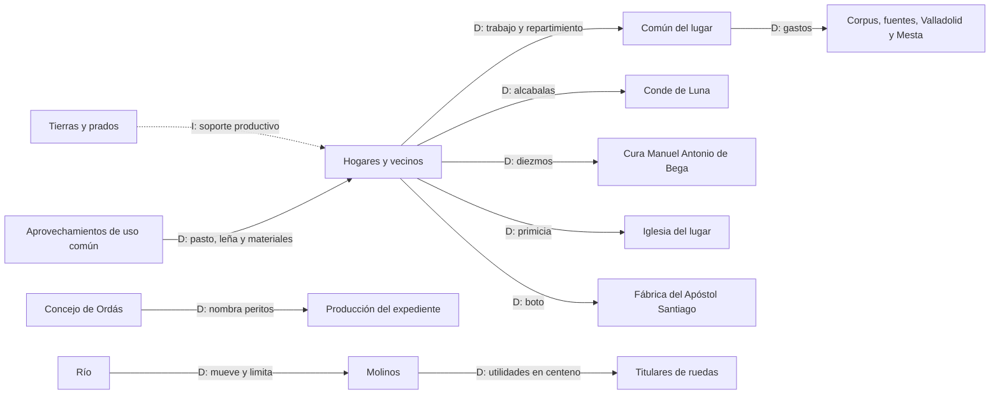

# Estudio histórico de Sorribos y Santibáñez de Ordás en 1752

## Versión canónica 1.1

**Estado:** activo  
**Versión:** 1.1  
**Fecha:** 18 de septiembre de 2026  
**Base documental exclusiva:** `project/20_TRABAJO_EDITORIAL/Edicion_Critica.md`, versión 3.6  
**Registro de control:** `Registro_Afirmaciones_Calculos_v1.md`  
**Auditoría de origen:** `Auditoria_Coherencia_0_1_0_6.md`  
**Base de redacción:** `main@bd1034a25e70caacae633fe8d54c7b79917db27a`  

## 0. Método, evidencia y alcance

Este estudio reconstruye la organización socioeconómica que permiten observar las Respuestas Generales de 1752 para el lugar de Sorribos y Santibáñez de Ordás. La base documental del Estudio Histórico es exclusivamente la edición paleográfica validada, publicada como Edición Crítica v3.5. Los análisis 0.1–0.6 han servido para formular preguntas y localizar cálculos, pero carecen de autoridad documental autónoma.

La trazabilidad se expresa mediante cuatro niveles:

- **D — dato:** contenido explícito de la Edición Crítica;
- **C — cálculo:** operación reproducible realizada con datos y equivalencias internas del expediente;
- **I — interpretación:** lectura histórica compatible con los datos, pero no formulada literalmente por la fuente;
- **L — límite:** ausencia, discrepancia o imposibilidad de cálculo que debe permanecer visible.

Las referencias entre corchetes remiten al `Registro_Afirmaciones_Calculos_v1.md`. Ese registro fija la formulación admitida, la respuesta, el folio y, para las magnitudes derivadas, la operación `CAL-*` correspondiente.

El estudio respeta las siguientes restricciones:

1. no convierte medidas históricas a unidades modernas;
2. solo usa las equivalencias internas expresas de cuatro quartales por fanega y cuatro montones por carro;
3. no establece relación entre el celemín de la respuesta 10 y la unidad principal de cabida;
4. no convierte cargas de cereal a fanegas o quartales;
5. no homogeneiza reales y maravedís mediante una equivalencia externa;
6. no reconstruye por residuo las partidas omitidas;
7. no suma categorías vecinales, residenciales, laborales y eclesiásticas como si fueran conjuntos disjuntos;
8. no transforma una utilidad fiscal nula en ausencia de valor económico;
9. no estima población total, renta familiar, producto total, comercio neto, desigualdad general o nivel de vida;
10. no presenta escenarios causales como crisis históricamente ocurridas.

La respuesta 10 declara una cabida total de 3.823 medidas y un celemín, mientras que sus partidas transcritas suman 3.811,5 medidas principales y siete celemines. Ambas magnitudes se conservan sin reconciliación artificial. Las respuestas 5 y 10 discrepan además sobre algunas clases o calidades de prados, montes y sotos. [D/C/L: TER-005–TER-010; CAL-001–CAL-002; LIM-004, LIM-007]

## 1. Tesis de conjunto

Sorribos y Santibáñez aparecen como una comunidad rural de señorío articulada alrededor de hogares agrarios, con una base territorial marcadamente cerealista —especialmente centenaria— y una economía mixta en la que participan lino, cebada, prados, ganadería, aprovechamientos de uso común documentado, molinos hidráulicos, apicultura, oficios y servicios. La circulación de recursos combina dinero, especie, trabajo y prestaciones, y conecta a vecinos, común del lugar, Concejo de Ordás, instituciones eclesiásticas y señorío. [I: INT-001, INT-002, INT-007]

El centeno domina la cabida cultivada comparable, pero no agota el sistema. El lino y la linaza aportan una rama complementaria; los prados y los espacios de uso común sostienen ganado y materiales; los molinos transforman cereal mediante energía hidráulica; la apicultura y el oficio de herrero amplían el repertorio productivo. [D/C/I: AGR-001–AGR-010; GAN-001–GAN-007; HID-001–HID-007; TRA-004]

La misma arquitectura contiene amortiguadores y vulnerabilidades. La diversidad productiva puede repartir funciones entre varios componentes, mientras que el predominio centenario, los descansos bienales, el agua compartida por los molinos y la ausencia de rentas propias del común concentran dependencias. Estas relaciones permiten construir escenarios analíticos; no demuestran que una crisis general ocurriera en 1752. [I: INT-003–INT-006, INT-009]

## 2. El lugar, la jurisdicción y la producción de la información

El expediente se refiere al `Lugar De Sorribos, y Santibañez` y sitúa la comparecencia en el Concejo de Ordás. Juan Álvarez y Remirio Rodríguez aparecen como vecinos y únicos oficiales de justicia; Domingo Díez y Francisco de Llorca fueron nombrados peritos por el Concejo, y Domingo Suárez lo fue de oficio. La declaración se produjo ante el juez subdelegado y concluyó con las firmas o signos registrados por la edición. [D: JUR-001–JUR-004; preámbulo, ff. 306r–306v; cierre, ff. 321r–321v]

### 2.1. El nombre de Sorribos y su continuidad histórica

El expediente de 1752 denomina al núcleo `Sorribos`. El topónimo aparece cuatro veces en tres unidades materiales: una en la Portada, dos en el folio 306r y una en el folio 306v. Todas ofrecen la misma lectura; una de las apariciones del folio 306r resulta especialmente concluyente al dividir el nombre entre líneas como `Sorri-` / `bos`. La forma `Sorribas`, utilizada en versiones anteriores de este proyecto, se rectifica por tanto como error de lectura paleográfica y no como variante del manuscrito. [D: JUR-001, TOP-001]

La documentación externa muestra continuidad histórica antes y después de 1752. Fernando Álvarez-Balbuena recoge para el actual Sorrios de Ordás varias formas medievales, entre ellas `Sorribios` y `Sorribos`, y documenta la pervivencia de `Sorribos` en el siglo XIX. PARES registra en 1715 el `lugar de Santibáñez de Sorribos`. Una escritura de 1831 publicada en la `Gaceta de Madrid` menciona el `Barrio de Sorribos` en relación con un vecino de Santibáñez. El Ayuntamiento de Santa María de Ordás denomina hoy `Sorrios` al barrio integrado en Santibáñez de Ordás. [I: TOP-002]

La identificación histórica adoptada es de seguridad muy alta: el `Sorribos` del expediente de 1752 corresponde al actual Sorrios. `Sorribas` no se incorpora a esta serie: no se ha localizado una fuente de Ordás que documente esa forma para este núcleo y existe, además, otra localidad leonesa llamada Sorribas en el actual municipio de Toral de los Vados. La documentación permite fijar la continuidad de identificación, pero no basta por sí sola para establecer una secuencia fonética exacta entre todas las formas medievales y la forma moderna. [I/L: TOP-002, TOP-003]

Fuentes externas: PARES, <https://pares.mcu.es/ParesBusquedas20/catalogo/description/12805146>; Fernando Álvarez-Balbuena García, «Estudiu histórico-etimolóxicu de la toponimia mayor del términu municipal d’Ordás (Llión)», <https://revistas.unileon.es/index.php/anada/article/view/6165>; `Gaceta de Madrid`, 7 de septiembre de 1864, <https://www.boe.es/gazeta/dias/1864/09/07/pdfs/GMD-1864-251.pdf>; Ayuntamiento de Santa María de Ordás, <https://www.aytosantamariadeordas.es/los-pueblos/santibanez-de-ordas/>.

`Lugar`, `común del lugar`, `vecinos` y `Concejo de Ordás` designan sujetos o escalas diferentes. El Concejo es el marco jurisdiccional mencionado en la comparecencia; el común es el sujeto al que las respuestas 23–27 atribuyen o niegan rentas y cargas; los vecinos son quienes contribuyen mediante repartimiento o pagan las alcabalas declaradas. El estudio no fusiona esas entidades. [D/I: JUR-002; FIS-005–FIS-008]

El lugar es de señorío. La respuesta 22 declara que, aunque lo sea, no paga cosa alguna al señor en el concepto allí tratado. Esta afirmación no equivale a ausencia general de derechos señoriales: la respuesta 28 documenta alcabalas enajenadas a favor del conde de Luna y la respuesta 29 un pozo de pesca de su propiedad. [D: JUR-005–JUR-006; FIS-012; R22, ff. 318r–318v; R28–R29, ff. 319r–319v]

La fuente es una declaración fiscal y pericial. Sus magnitudes son cabidas, rendimientos, precios o utilidades reguladas según el interrogatorio, no una contabilidad exhaustiva de producción, población o riqueza. Esta naturaleza explica tanto su capacidad descriptiva como sus silencios. [I/L: TER-010; LIM-001–LIM-010]

## 3. Población fiscal, residencia y vivienda

La respuesta 21 declara 18 vecinos y ocho medios vecinos —incluidas dos viudas— y afirma que componen 26 `avitadores`. Añade ocho residentes que no se consideran vecinos porque no contribuyen con los tributos reales y declara que no hay casa de campo ni alquería. [D/C: DEM-001, DEM-002, DEM-004; CAL-019; R21, f. 318r]

| Categoría declarada | Magnitud | Alcance |
|---|---:|---|
| Vecinos | 18 | Categoría fiscal y vecinal. |
| Medios vecinos | 8 | Incluye dos viudas. |
| `Avitadores` resultantes | 26 | Suma textual y aritmética de vecinos y medios vecinos. |
| Residentes no considerados vecinos | 8 | No contribuyen con los tributos reales según la respuesta. |

Los 26 `avitadores` no constituyen una cifra de población individual, y los ocho residentes no deben sumarse como si todas las categorías representaran personas u hogares equivalentes. El expediente no ofrece tamaño familiar, edades ni número total de habitantes. [L: LIM-001]

La respuesta 22 registra 40 casas habitables, dos arruinadas y quince pajares separados destinados a paja y ganado. Vivienda, hogar y condición vecinal no son variables intercambiables: las 40 casas no permiten inferir 40 unidades domésticas independientes ni calcular ocupación media. [D/I: DEM-003; R22, ff. 318r–318v]

El expediente declara también cinco pobres de solemnidad, un cura y dos capellanes, y ausencia de convento y hospital local. Esos datos describen posiciones o instituciones concretas, pero no autorizan una tasa de pobreza ni una estructura demográfica completa. [D/L: R30, R36, R38–R39, ff. 319v–321r; LIM-001, LIM-008]

## 4. Hogares, trabajo y estructura social observable

La organización doméstica se ve con claridad en dos pasajes. No hay casa destinada al esquileo: cada propietario esquila su ganado en su habitación. Además, catorce de los dieciocho jornaleros son hijos de familia en compañía de sus padres y tres son criados sirvientes. [D: GAN-007, TRA-001; R18, f. 316r; R35, ff. 320r–320v]

La respuesta 35 compone los 18 jornaleros como 14 hijos de familia, tres criados sirvientes y un hombre que vive ocupado solo en ese ejercicio. También declara 24 labradores. Las categorías pueden solaparse con la vecindad y con otros oficios; no se suman para producir una población activa. [D/C: TRA-001, TRA-002; CAL-018]

| Categoría | Dato regulado | Cautela |
|---|---:|---|
| Jornaleros | 18 | Categoría compuesta; no equivale a hogares. |
| Labradores | 24 | Puede solaparse con oficio, propiedad o vecindad. |
| Utilidad diaria del jornalero | 2,5 reales | Incluye comida valorada en 1,5 reales. |
| Utilidad diaria del labrador | 3 reales | Incluye comida valorada en 1,5 reales. |

Estas cantidades son regulaciones por día trabajado. El expediente no proporciona número anual de jornadas, por lo que no se transforman en ingresos anuales ni en salarios monetarios efectivamente cobrados. [D/L: TRA-003; LIM-002]

El único herrero declarado pasa la mayor parte del año en el ejercicio de labrador y recibe una regulación adicional de medio real diario por el oficio. Este caso documenta pluriactividad individual y desaconseja dividir la comunidad en sectores profesionales rígidos. [D/I: TRA-004, INT-008; R33, f. 320r]

La diferenciación social es visible en la coexistencia de pobres de solemnidad, criados, jornaleros, labradores, titulares de molinos o colmenas, clérigos, oficiales de justicia y perceptores institucionales. Sin inventarios completos por hogar, esa diversidad no puede convertirse en una distribución general de riqueza. [I/L: LIM-008, INT-010]

## 5. Territorio, clasificación y sistema de medidas

La respuesta 3 describe el término por linderos y dimensiones: una circunferencia de una legua y media y 787 varas, 2.500 varas de Oriente a Poniente y 2.708 de Norte a Sur. Estas magnitudes se conservan como geometría local y no se convierten en superficie moderna. [D: R3, ff. 307r–307v]

La respuesta 4 distingue trece clases de tierras y aprovechamientos: ferrañales centenales de secano; linares de regadío; linares de secano; centenales de secano; prados cercados de regadío; prados cercados de secano; prados abiertos de regadío; prados abiertos de secano; prados entreparedes; matorrales; eras o sitios; montes de robles altos y bajos; y soto de negrillos, alisos y fresnos. [D: TER-001; R4, ff. 307v–308v]

La respuesta 5 distribuye calidades de forma distinta según la clase. No existe una escala única aplicable a todas: unas categorías tienen tres calidades, otras dos y algunas una sola. [D: TER-002; R5, ff. 308v–309r]

La respuesta 9 declara que no se usa una medida superficial cierta reducible a varas castellanas. Las tierras de pan llevar se entienden por el quartal de grano que cabe en ellas; los prados de guadaña se regulan por quartales de sembradura y otras clases quedan al juicio de peritos. La única relación metrológica interna expresamente declarada es cuatro quartales por fanega. No consta relación entre el celemín de la respuesta 10 y ese sistema. [D/L: TER-003–TER-005; LIM-004; R9, ff. 309v–310r]

La medida de cabida es, por tanto, una convención agraria local relacionada con sembradura, calidad y uso, no una superficie homogénea. [I: INT-003]

## 6. Cabida, calidades y discordancias internas

La respuesta 10 declara un total de 3.823 medidas y un celemín. La suma de sus partidas expresadas en la unidad principal es 3.811,5 y quedan siete celemines separados. La falta de equivalencia impide combinarlos y también impide convertir la diferencia en una cabida residual atribuible a montes u otra categoría. [D/C/L: TER-006, TER-007; CAL-001; LIM-004]

| Calidad | Medidas principales sumadas | Porcentaje sobre 3.811,5 |
|---|---:|---:|
| Primera | 666 | 17,47 % |
| Segunda | 1.398 | 36,68 % |
| Tercera | 1.747,5 | 45,85 % |
| **Total** | **3.811,5** | **100 %** |

El cálculo agrupa exclusivamente partidas en la unidad principal. Los siete celemines permanecen fuera. [C: TER-008; CAL-002]

El contraste entre respuestas 5 y 10 deja tres advertencias principales. R5 atribuye primera y segunda calidad a los prados cercados de secano, mientras R10 cuantifica solo segunda y la llama única; R5 declara montes de primera y tercera calidad, pero R10 no los cuantifica; y R5 asigna primera y tercera calidad a los sotos, mientras R10 cuantifica únicamente tercera. Estas diferencias pertenecen a la fuente y no se corrigen por armonización editorial. [L: TER-009; LIM-007]

Los rendimientos de la respuesta 12 son regulaciones por clase y calidad, no una cosecha anual observada. [D: TER-010]

## 7. Base agraria: centeno, descanso y otros cultivos

La respuesta 11 enumera centeno, cebada, lino, linaza y yerba. Dentro de las partidas comparables de R10, las cuatro clases cultivadas —ferrañales, linares de regadío, linares de secano y centenales— suman 2.953,5 medidas principales; las tierras centenales suman 2.750,5. [D/C: AGR-001, AGR-004; CAL-003–CAL-004]

Las centenales representan el 93,13 % de esa cabida cultivada comparable. Si el denominador es el conjunto de 3.811,5 medidas principales explícitas de R10, representan el 72,16 %. El primer porcentaje describe la composición del cultivo comparable; el segundo, el peso dentro del desglose principal completo. [C: AGR-005; CAL-005–CAL-006]

| Magnitud | Resultado | Denominador |
|---|---:|---|
| Cabida cultivada comparable | 2.953,5 | Cuatro clases cultivadas comparables. |
| Cabida centenal | 2.750,5 | Partidas centenales de R10. |
| Peso centenal | 93,13 % | 2.750,5 / 2.953,5. |
| Peso centenal alternativo | 72,16 % | 2.750,5 / 3.811,5. |

Las tierras centenales producen un año y descansan otro. La respuesta 12 regula cuatro quartales de centeno por quartal sembrado en primera calidad, tres en segunda y dos y medio en tercera. [D: AGR-002, AGR-007; R12, f. 313v]

Un índice analítico que aplica mecánicamente los ciclos declarados produce 1.578,25 unidades activas medias y un peso centenal del 87,14 %. No es superficie efectivamente sembrada ni cosecha observada: solo hace visible el efecto estructural de los descansos bajo los coeficientes adoptados. [C/I: AGR-006; CAL-007–CAL-008]

El predominio de las tierras centenales y la recurrencia del centeno en diezmos, primicia, utilidades molineras y valoraciones de ganado permiten caracterizarlo como la base cerealista del sistema. [I: INT-001]

## 8. Lino, cebada, prados y complementariedad productiva

Los linares de regadío alternan lino con cebada y los linares de secano lino con centeno. La respuesta 12 distingue rendimientos de linaza, fibra de lino y cereal según riego y calidad. Estas series deben conservarse por separado. [D: AGR-003, AGR-008; R4, ff. 307v–308r; R12, ff. 312v–313r]

Las partidas de R10 suman 149,5 medidas principales de linares de regadío y 19,5 de secano. Su escala es menor que la centenal, pero la alternancia y la diferenciación entre semilla y fibra documentan una función complementaria específica. [C/I: CAL-001; INT-002, INT-003]

La respuesta 16 incluye 40 fejes de lino de cuatro libras en la regulación decimal. La multiplicación interna da 160 libras; no representa la producción total de lino. [D/C: AGR-009; CAL-009; R16, f. 315r]

Los prados se distinguen por cerramiento, riego y ciclo. Unos producen `pelo, y otoño`; otros un solo pelo; los prados entre pares producen un año y descansan otro. La respuesta 12 declara además que cuatro montones de yerba componen un carro. [D: AGR-010; R4, ff. 307v–308r; R12, ff. 313v–314r]

| Tipo de prado | 1.ª calidad | 2.ª calidad | 3.ª calidad | Ciclo declarado |
|---|---:|---:|---:|---|
| Cercado de regadío | 2,5 montones | 2 | — | `pelo, y otoño` |
| Cercado de secano | — | 1,5 | — | `pelo, y otoño` |
| Abierto de regadío | 2 | 1,5 | 1 | un pelo |
| Abierto de secano | — | 1 | 0,5 | un pelo |
| Entre pares | — | 1 | 0,5 | produce un año y descansa otro |

La combinación de cereal, lino, cebada, prados y yerba muestra diversidad interna sin negar el predominio centenario. [I: INT-002, INT-003]

## 9. Ganadería y aprovechamientos de uso común documentado

La respuesta 20 regula utilidades y valores para vacuno, yeguas, ganado de cerda y lanar, además de animales de labor. Son valores por cabeza o por uso, no un censo de existencias. [D: GAN-001; R20, ff. 316v–318r]

| Especie o concepto | Dato regulado |
|---|---:|
| Vaca: cría | 22 reales |
| Vaca: esquilmo anual moderado | 11 reales |
| Yegua: cría mular | 200 reales |
| Yegua: potro o potra | 50 reales |
| Yegua: esquilmo anual | 125 reales |
| Cerda de cría | 16 reales/año |
| Oveja: esquilmo anual total | 5 reales |
| Cordero: añino | 8 maravedís |
| Carnero o borrego: lana | 2 reales/año |
| Buey de labranza | 150 reales |
| Vaca de labranza | 100 reales |
| Buey dado `arenta` | 5 quartales de centeno |
| Vaca dada `arenta` | 4 quartales de centeno |

Matorrales, eras, sitios, montes y soto no reciben utilidad en la respuesta 12 porque sirven para pasto de los ganados del común. Otras respuestas atribuyen a algunas de esas clases resguardo del cereal, leña o madera para puentes y puertas del río. Esos pasajes documentan funciones y uso común; no prueban por sí solos un título de propiedad ni una administración común de todos los espacios. [D/I: GAN-002, INT-004; R4, ff. 307v–308v; R12, f. 314r]

Los aprovechamientos de uso común documentado forman así parte del soporte material de la economía: conectan ganado, combustible, cereal e infraestructura. Esta función no debe confundirse con renta monetaria ni con propiedad acreditada. [I: INT-004]

El esquileo doméstico integra la ganadería en el espacio residencial. Tampoco hay base para afirmar que toda la producción ganadera se destinara al consumo doméstico o al mercado. [D/L: GAN-007; LIM-009]

## 10. Río, molinos y capacidad de transformación

La respuesta 17 describe cuatro casas de molinos harineros movidas por el agua del río. Sus ruedas descritas se distribuyen como 3 + 2 + 2 + 1: ocho en total. Existe además un molino venturero cuyo número de ruedas no se declara. [D/C/L: HID-001, HID-002, HID-005; CAL-012; LIM-010; R17, ff. 315r–316r]

| Activo | Titular o titulares declarados | Utilidad regulada |
|---|---|---:|
| Molino 1, rueda 1 | Manuel Antonio, cura | 2 cargas de centeno |
| Molino 1, rueda 2 | Manuel y Francisco Fernández | 2 cargas |
| Molino 1, rueda 3 | Manuel González y Francisco Díez | 2 cargas |
| Molino 2, rueda 1 | Manuel García y consortes | 4 cargas |
| Molino 2, rueda 2 | Margarita García y Bartholomé Fernández | 4 cargas |
| Molino 3, dos ruedas | Andrés Suárez | 8 cargas en conjunto |
| Molino 4, una rueda | Marcos Suárez | 4 cargas |
| Molino venturero | `otro Don Manuel` | 4 quartales de centeno |

Las utilidades de las ocho ruedas descritas suman 26 cargas de centeno: tres ruedas por dos cargas y cinco por cuatro. Los cuatro quartales del venturero permanecen separados porque no consta equivalencia entre carga y quartal. [C/L: HID-004; CAL-013; LIM-005]

La propiedad o participación en las ruedas aparece repartida entre varios titulares y consortes. Esa pluralidad no debe convertirse automáticamente en copropiedad de cada casa ni en garantía de continuidad operativa. [D/I: HID-003, INT-005]

El expediente atribuye la regulación reducida de determinadas ruedas a que el río lleva los puentes y a que muelen solo la mitad del año; el venturero funciona algunos meses de invierno con el agua disponible. Estos hechos documentan dependencia hidráulica. No permiten afirmar que la pérdida de puentes paralizara necesariamente todas las ruedas ni reconstruir una crisis concreta. [D/I: HID-005–HID-007; INT-009]

## 11. Apicultura y pequeños activos productivos

La respuesta 19 declara 18 pies de abejas distribuidos entre cinco titulares. La suma 7 + 6 + 3 + 1 + 1 verifica el total. [D/C: GAN-003, GAN-004; CAL-020; R19, f. 316v]

| Titular | Pies | Utilidad a 2 reales por pie |
|---|---:|---:|
| Agustín García Ordás | 7 | 14 reales |
| Francisco Díez | 6 | 12 reales |
| Manuel García | 3 | 6 reales |
| Juan Fernández | 1 | 2 reales |
| Margarita García | 1 | 2 reales |
| **Total** | **18** | **36 reales** |

La utilidad anual total regulada es 36 reales. Los dos mayores titulares reúnen 13 pies, el 72,22 % del total. Esta proporción describe concentración de colmenas, no desigualdad patrimonial general. [C/L: GAN-005, GAN-006; CAL-010–CAL-011; LIM-008]

La coincidencia de algunos nombres en molinos y colmenas permite observar combinación individual de activos en casos concretos, pero no reconstruir patrimonios completos. [I/L: LIM-008]

## 12. Derechos eclesiásticos y señoriales

La respuesta 15 declara diezmos, primicia y `boto`. Los diezmos corresponden al cura Manuel Antonio de Bega —`Vega` es variante documental—; la primicia, a la iglesia del lugar; y el boto, a la fábrica del Apóstol Santiago. La identificación contextual con el Voto de Santiago no modifica el término ni el receptor declarados. [D: FIS-001, FIS-002; R15, f. 314v]

| Concepto | Cuantía regulada | Perceptor |
|---|---|---|
| Diezmo de centeno | 30 cargas | Cura Manuel Antonio de Bega (var. Vega) |
| Diezmo de cebada | 2 cargas | Mismo perceptor |
| Diezmo de trigo | 5 fanegas de vecinos que siembran fuera del término | Mismo perceptor |
| Diezmo de lino | 40 fejes de 4 libras = 160 libras | Mismo perceptor |
| Diezmos menudos | 140 reales | Mismo perceptor |
| Primicia | 26 quartales de centeno | Iglesia del lugar |
| Boto | 24 quartales; producto elidido en la serie | Fábrica del Apóstol Santiago |

Las unidades son heterogéneas y no se agregan. Tampoco se asigna por inferencia el producto elidido de los 24 quartales del boto. [D/L: FIS-003, FIS-004; LIM-005]

Las alcabalas están enajenadas a favor del conde de Luna y los vecinos pagan 633 reales al año por ese derecho. El pozo de pesca del conde está arrendado en nueve reales, declarados como utilidad. Estos derechos deben distinguirse del concepto de establecimiento del suelo para el cual la respuesta 22 declara ausencia de pago. [D: JUR-005, JUR-006, FIS-012]

El expediente combina, por tanto, activos productivos distribuidos entre varios particulares con derechos institucionales de percepción asignados a receptores definidos. Esta diferencia de naturaleza impide reducir la estructura económica a una sola dimensión de propiedad. [I: INT-002, INT-007]

## 13. Hacienda del común y servicios colectivos

Las respuestas 23 y 24 declaran que el común no tiene propios, arbitrios ni renta alguna. La respuesta 25 indica que debe satisfacer 200 reales anuales por la festividad del Corpus, ocho por limpiar las fuentes, quince al Hospital de Inocentes de Valladolid y diez por derecho de Mesta en León, además de otras cantidades sin cuantificar. [D: FIS-005, FIS-006; R23–R25, ff. 318v–319r]

| Partida explícita | Reales/año |
|---|---:|
| Festividad del Corpus | 200 |
| Limpieza de fuentes | 8 |
| Hospital de Inocentes de Valladolid | 15 |
| Derecho de Mesta en León | 10 |
| **Subtotal explícito** | **233** |
| Otras cantidades | No cuantificadas |

Los 233 reales son un subtotal explícito, no un presupuesto exhaustivo. Al carecer de propios para esas cantidades, el común las paga por repartimiento entre los vecinos. [D/C: FIS-006, FIS-007]

El común declara además no tener cargo de justicia ni estar cargado de servicio ordinario o extraordinario. Estas ausencias se conservan en su alcance literal y no cancelan los gastos de R25. [D: FIS-008]

La taberna funciona por vecera entre los vecinos porque no encuentra arrendatario y no produce utilidad al común ni a particular. Es un servicio rotatorio documentado, pero no una prueba suficiente para generalizar una forma de gobierno económico a todas las actividades. [D/I: TRA-005; R29, f. 319v]

La secuencia `necesidad colectiva → gasto → repartimiento → vecinos` resume una dependencia explícita. La ausencia de propios, arbitrios y rentas hace visible esa dependencia, aunque no autoriza a afirmar insolvencia o falta de otros recursos no preguntados. [D/I: INT-006]

## 14. Monetización y conexiones exteriores

La fuente utiliza dinero en precios, utilidades ganaderas, apicultura, trabajo, gastos, alcabalas y arrendamientos; utiliza especie en diezmos, primicia, boto y utilidades molineras; y registra servicios o usos sin renta particular. La economía aparece parcialmente monetizada, no como un sistema puramente monetario ni como una economía cerrada. [D/I: INT-007]

Las cantidades monetarias institucionales que pueden agregarse sin conversión son 633 reales de alcabalas, 233 de partidas explícitas de R25 y 140 de diezmos menudos: un mínimo de 1.006 reales. No es carga fiscal total, producto, renta ni salida neta del término. Incluye conceptos de naturaleza diferente y omite prestaciones en especie y partidas sin cuantía monetaria. [C/L: FIS-009; CAL-014]

Los destinos externos inequívocos de R25 suman al menos 25 reales: quince a Valladolid y diez a León. Representan el 10,73 % del subtotal de 233 reales y el 2,49 % del mínimo monetario de 1.006. Cada porcentaje conserva su denominador. [C: FIS-010, FIS-011; CAL-015–CAL-017]

Otros indicios de conexión supralocal son las cinco fanegas de trigo de vecinos que siembran fuera del término, las alcabalas enajenadas al conde de Luna y el boto destinado a la fábrica del Apóstol Santiago. El expediente documenta relaciones exteriores, pero no permite calcular importaciones, exportaciones, balanza comercial ni grado de autosuficiencia. [D/L: FIS-002–FIS-004; LIM-009]

Los precios de la respuesta 14 son regulaciones ordinarias por quinquenio: dos reales y 25 maravedís por quartal de centeno; dos reales por quartal de cebada; cuatro por quartal de linaza; un real y seis maravedís por libra de lino; cuatro reales por quartal de trigo; y quince por carro de yerba. Su existencia no demuestra que toda la producción se vendiera ni que cada transacción usara esos valores. [D/I: R14, ff. 314r–314v; LIM-006, LIM-009]

## 15. Vulnerabilidades, mecanismos y amortiguadores

La tabla siguiente separa hechos documentados, mecanismos inferidos y efectos posibles. Ningún escenario recibe probabilidad ni se afirma como acontecimiento histórico salvo donde la fuente documenta una limitación.

| Escenario analítico | Evidencia observada | Mecanismo inferido | Efecto posible | Amortiguadores documentados | Límite |
|---|---|---|---|---|---|
| Mala cosecha cerealista | Predominio centenal; centeno en cargas y utilidades. | Una caída afecta al componente territorial dominante y a flujos en especie. | Menor cereal disponible para usos no cuantificables. | Lino, cebada, prados, ganado y apicultura. | No consta una mala cosecha general ni puede cuantificarse compensación. |
| Perturbación hidráulica | El río lleva puentes; algunas ruedas muelen medio año; venturero estacional. | El agua es factor físico compartido. | Reducción de capacidad de molienda o de utilidad. | Cuatro casas y ocho ruedas descritas ofrecen pluralidad potencial. | No consta paralización simultánea ni independencia efectiva entre unidades. |
| Restricción de aprovechamientos comunes | Pasto común y funciones de montes, eras, sitios y soto. | Varias funciones dependen de los mismos espacios. | Efectos sobre ganado, combustible, cereal o infraestructura. | Diversidad de clases y recursos. | No consta que la restricción ocurriera ni un título de propiedad común. |
| Aumento de necesidad colectiva | Común sin propios, arbitrios ni renta; gastos por repartimiento. | El gasto adicional puede trasladarse a los vecinos. | Mayor exigencia monetaria o distributiva. | Repartimiento como mecanismo operativo existente. | No constan reservas, crédito, auxilios ni una necesidad extraordinaria concreta. |

El barbecho o descanso bienal no se califica como ineficiencia. Es una práctica estructural documentada que reduce la superficie activa bajo el índice analítico y puede tener funciones agronómicas que el expediente no detalla. [D/I: AGR-002, AGR-006; INT-003]

La pluralidad de molinos y titulares ofrece redundancia potencial de unidades, no redundancia operativa garantizada. Del mismo modo, la diversidad productiva es un amortiguador posible, pero el expediente no proporciona elasticidades ni balances que permitan medir su capacidad de compensación. [I/L: INT-005, INT-009]

## 16. Modelo socioeconómico integrado

El sistema puede describirse mediante relaciones documentadas y conexiones interpretativas. Las flechas sólidas de este esquema representan transferencias o usos explícitos; las discontinuas, integración funcional inferida.

El hogar aparece como punto de articulación de trabajo, residencia, esquileo y contribución, no como una unidad contable reconstruida. Los aprovechamientos de uso común aportan funciones materiales; el común recauda por repartimiento para gastos; el Concejo nombra peritos; Iglesia y señorío reciben conceptos específicos. Mantener estas entidades separadas evita convertir una red plural en un actor colectivo único. [D/I: INT-002, INT-004, INT-006–INT-008]

La economía puede calificarse, dentro del corpus, como rural y agraria, doméstica en varias formas de organización laboral, cerealista en su base territorial, mixta en sus componentes y parcialmente monetizada. Estas fórmulas describen relaciones observadas; no sustituyen una comparación con otras localidades. [I: INT-001, INT-002, INT-007]

## 17. Lo que el expediente no permite saber

El corpus no permite reconstruir con rigor:

- población total por individuos;
- tamaño medio de los hogares;
- renta anual familiar;
- número anual de jornadas;
- producto agrario total;
- producción efectivamente cosechada en un año concreto;
- consumo y destino predominante de la producción;
- reservas, deudas y crédito;
- distribución completa de tierras, ganado y patrimonio;
- desigualdad general;
- comercio neto, importaciones o exportaciones;
- carga fiscal como porcentaje de renta;
- nivel de vida absoluto o comparado;
- equivalencia entre celemín y unidad principal de cabida;
- equivalencia entre carga, fanega y quartal para las partidas de R16–R17;
- equivalencia interna entre real y maravedí;
- número de ruedas del molino venturero.

Estos límites no son defectos que deban rellenarse con supuestos. Definen la frontera entre lo que la fuente sostiene y lo que requeriría bibliografía comparativa, nuevas fuentes o un criterio metodológico adicional. [L/I: LIM-001–LIM-010; INT-010]

## 18. Conclusión

La evidencia permite reconstruir una comunidad organizada mediante relaciones superpuestas entre hogares agrarios, recursos territoriales, aprovechamientos de uso común, transformación hidráulica y derechos institucionales. El centeno ocupa el centro cuantitativo de la cabida cultivada comparable y reaparece en prestaciones y utilidades; lino, cebada, prados, ganado, colmenas, molinos y oficios amplían el sistema sin borrar esa centralidad. [D/C/I: AGR-001–AGR-010; GAN-001–GAN-007; HID-001–HID-007; INT-001, INT-002]

El trabajo se integra en hogares, servicios y pluriactividad; los gastos del común recaen por repartimiento; Iglesia y señorío reciben conceptos diferenciados; el dinero convive con especie y servicios. Esta arquitectura es más precisa que una etiqueta de economía cerrada, autosuficiente, de subsistencia o plenamente mercantil, ninguna de las cuales puede demostrarse con el corpus vigente. [D/I: TRA-001–TRA-005; FIS-001–FIS-012; INT-006–INT-008]

Las vulnerabilidades más claras proceden del predominio cerealista, los ciclos de descanso, la dependencia hidráulica y la falta de rentas propias del común. Sus posibles amortiguadores son la diversidad de actividades, la pluralidad de unidades productivas y los aprovechamientos compartidos. Son relaciones estructurales, no prueba de crisis concretas. [I: INT-003–INT-006, INT-009]

El resultado canónico es, por tanto, una explicación trazable de cómo se conectan producción, trabajo, recursos y derechos en 1752, acompañada de una declaración explícita de aquello que no puede medirse. [I: INT-010]

---

# Anexo A. Cuadros cuantitativos canónicos

Este anexo concentra las operaciones admitidas. Los operandos, folios y condiciones completas constan en el registro.

| ID | Operación | Resultado | Condición |
|---|---|---:|---|
| CAL-001 | Suma de partidas principales de R10 | 3.811,5 medidas + 7 celemines | No combinar unidades. |
| CAL-002 | Agrupación por calidad | 666 / 1.398 / 1.747,5 | Base 3.811,5. |
| CAL-003 | Cabida cultivada comparable | 2.953,5 | Cuatro clases cultivadas. |
| CAL-004 | Cabida centenal | 2.750,5 | Partidas identificadas. |
| CAL-005 | 2.750,5 / 2.953,5 | 93,13 % | Denominador cultivado comparable. |
| CAL-006 | 2.750,5 / 3.811,5 | 72,16 % | Denominador principal explícito. |
| CAL-007 | Índice activo según ciclos | 1.578,25 | Escenario mecánico. |
| CAL-008 | Componente centenal del índice | 87,14 % | Depende de CAL-007. |
| CAL-009 | 40 fejes × 4 libras | 160 libras | Partida decimal de lino. |
| CAL-010 | 18 pies × 2 reales | 36 reales | Utilidad apícola regulada. |
| CAL-011 | 13 / 18 | 72,22 % | Concentración de colmenas. |
| CAL-012 | 3 + 2 + 2 + 1 | 8 ruedas | Excluye venturero. |
| CAL-013 | 3 × 2 + 5 × 4 cargas | 26 cargas | Sin conversión. |
| CAL-014 | 633 + 233 + 140 | 1.006 reales | Mínimo parcial. |
| CAL-015 | 15 + 10 | 25 reales | Destino exterior explícito. |
| CAL-016 | 25 / 233 | 10,73 % | Denominador R25. |
| CAL-017 | 25 / 1.006 | 2,49 % | Denominador mínimo monetario. |
| CAL-018 | 14 + 3 + 1 | 18 jornaleros | Control de composición. |
| CAL-019 | 18 + 8 | 26 `avitadores` | No población total. |
| CAL-020 | 7 + 6 + 3 + 1 + 1 | 18 pies de abejas | Control de composición. |

# Anexo B. Registro de afirmaciones y cálculos

El índice normativo de trazabilidad es `project/30_RESULTADOS/ESTUDIO_HISTORICO/Registro_Afirmaciones_Calculos_v1.md`. Ninguna afirmación sustantiva nueva debe incorporarse al canónico sin añadir antes una entrada con nivel, evidencia, estado y cautela.

# Anexo C. Relaciones económicas revisadas

| Relación | Nivel | Base | Cautela |
|---|---:|---|---|
| Vecinos → común → gastos | D | FIS-005–FIS-008 | Repartimiento documentado; no presupuesto total. |
| Vecinos → conde de Luna | D | JUR-006, FIS-012 | Distinguir alcabalas, pozo y suelo. |
| Productores → perceptores eclesiásticos | D | FIS-001–FIS-004 | Unidades heterogéneas. |
| Río → molinos | D/I | HID-001–HID-007 | Dependencia común; sin paralización total inferida. |
| Tierras/prados/comunes → hogares y ganado | D/I | AGR-001–AGR-010, GAN-001–GAN-002 | Función documentada; propiedad no presumida. |
| Diversidad → amortiguación | I | INT-002–INT-005 | Potencial no cuantificado. |

# Anexo D. Mapa revisado de vulnerabilidades

| Nodo | Fragilidad observada | Dependencia latente | Amortiguador | Prohibición interpretativa |
|---|---|---|---|---|
| Centeno | Predominio cuantitativo y descanso bienal | Flujos en especie vinculados | Otros cultivos, prados, ganado y colmenas | No afirmar mala cosecha ocurrida. |
| Agua y molinos | Puentes llevados y molienda parcial | Factor hidráulico compartido | Pluralidad potencial de casas y ruedas | No afirmar independencia ni paralización general. |
| Aprovechamientos comunes | Varias funciones materiales | Pasto, leña, cereal e infraestructura conectados | Diversidad de espacios | No convertir uso en propiedad. |
| Hacienda común | Sin propios, arbitrios ni renta | Gasto trasladado por repartimiento | Mecanismo de reparto operativo | No afirmar insolvencia. |

# Anexo E. Concordancia de las versiones 0.1–0.6

| Material previo | Destino en la versión 1.0 |
|---|---|
| 0.1 — exploración inicial | Sustituida como narración; solo sobreviven afirmaciones admitidas. |
| 0.2 — análisis cuantitativo | Cálculos validados concentrados en el Anexo A. |
| 0.3 — reconstrucción integrada | Argumentos reformulados bajo IDs del registro. |
| 0.4 — matriz y grafo | Relaciones reconstruidas en la sección 16 y el Anexo C. |
| 0.5 — vulnerabilidades | Escenarios revisados en la sección 15 y el Anexo D. |
| 0.6 — síntesis integral | Base de redacción reestructurada y corregida. |
| Auditoría 0.1–0.6 | Memoria de problemas y prueba de regresión. |

La versión 1.1 sustituye a 1.0 como texto canónico tras la rectificación paleográfica e histórica del topónimo `Sorribos`. Los documentos 0.2–0.6 permanecen como análisis derivados e historial intelectual, no como autoridades históricas. Los documentos 0.2–0.6 permanecen como análisis derivados e historial intelectual, no como autoridades históricas.

