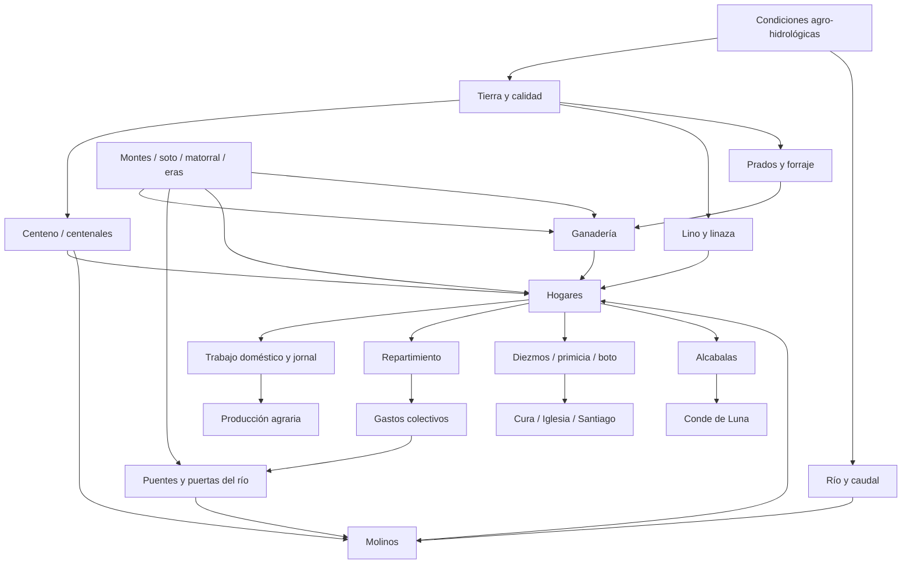
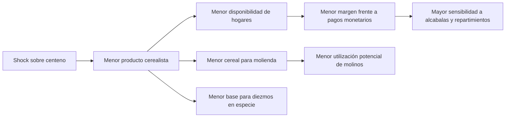
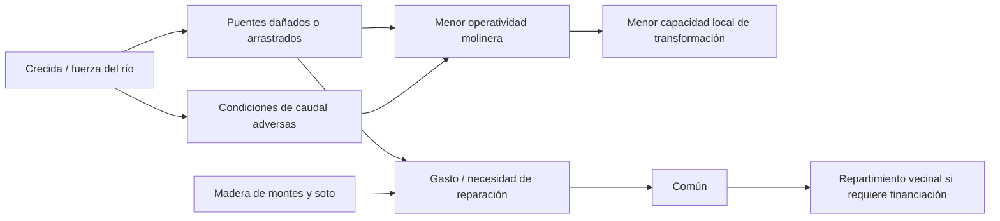
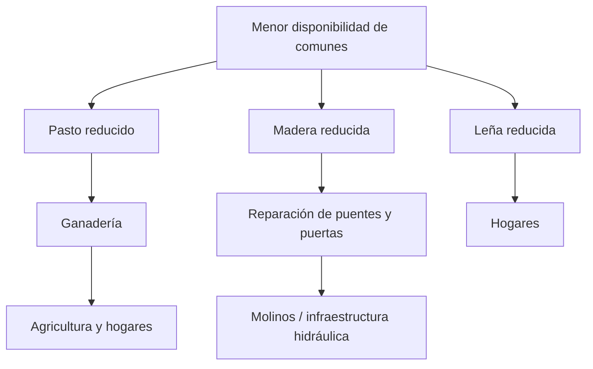
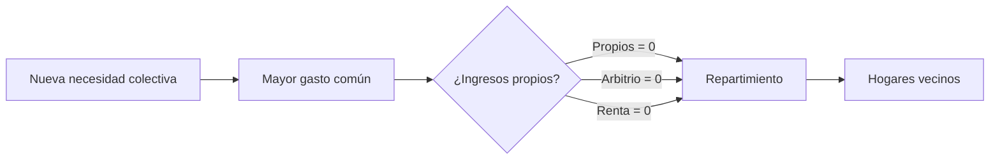

# Mapa de vulnerabilidades económicas

## Sorribas y Santibáñez de Ordás en 1752

**Estado:** análisis derivado activo  
**Versión:** 0.5 — vulnerabilidades, dependencias y mecanismos de propagación  
**Fecha:** 16 de septiembre de 2026  
**Base documental exclusiva:** `project/20_TRABAJO_EDITORIAL/Edicion_Critica.md`, versión 3.5  
**Análisis cuantitativo de apoyo:** `project/30_RESULTADOS/ESTUDIO_HISTORICO/Analisis_Cuantitativo.md`, versión 0.2  
**Reconstrucción económica de apoyo:** `project/30_RESULTADOS/ESTUDIO_HISTORICO/Reconstruccion_Economica_Integrada.md`, versión 0.3  
**Matriz y grafo de apoyo:** `project/30_RESULTADOS/ESTUDIO_HISTORICO/Matriz_Contabilidad_Social_y_Grafo_Economico.md`, versión 0.4  
**Base técnica:** `main@a612df60e5e4f079f6d9aa9a97f810e86805fcca`  
**Manual aplicable:** Manual Editorial v1.6

## 0. Objeto y límites

Este documento identifica las **dependencias económicas**, los **puntos de fallo** y los **mecanismos de propagación** que pueden reconstruirse a partir del Catastro de Ensenada de Sorribas y Santibáñez de Ordás de 1752.

No es una reconstrucción de crisis efectivamente ocurridas salvo cuando el propio expediente describe una perturbación concreta. Tampoco atribuye probabilidades históricas no documentadas. Su objeto es distinguir:

- **fragilidad observada:** el expediente registra directamente un fallo, interrupción o limitación;
- **dependencia estructural:** una actividad necesita un recurso o institución cuya pérdida afectaría a otras partes del sistema, aunque el fallo no conste en 1752;
- **mecanismo de propagación:** relación causal plausible que deriva directamente de funciones documentadas;
- **amortiguador:** recurso, diversidad, organización o redundancia que puede limitar el daño y que también está documentado.

La base documental del Estudio Histórico sigue siendo exclusivamente la edición paleográfica validada. Los documentos v0.2, v0.3 y v0.4 son instrumentos derivados y no amplían el corpus.

Se mantienen las restricciones metodológicas vigentes:

1. no se convierten medidas históricas a hectáreas, kilogramos ni moneda moderna;
2. no se introducen equivalencias externas entre reales y maravedís, entre cargas y quartales o entre la medida principal de tierra y el celemín;
3. no se reconstruye por residuo la cabida omitida de montes;
4. no se inventan volúmenes de producción, autoconsumo, comercio o renta total;
5. no se supone que una carga institucional desaparezca, aumente o se reduzca tras una mala cosecha si el expediente no lo indica;
6. no se supone que todos los hogares tengan la misma exposición a tierra, ganado, molinos, abejas o cargas;
7. no se confunde `utilidad fiscal = 0` con `valor económico = 0`;
8. no se interpreta una dependencia latente como evidencia de crisis efectivamente producida.

---

# 1. Marco de vulnerabilidad histórica

Para cada vulnerabilidad se registran cuatro dimensiones cualitativas derivadas del propio expediente.

| Dimensión | Pregunta | Criterio documental |
|---|---|---|
| Exposición | ¿Existe un recurso o flujo susceptible de interrupción? | relación funcional explícita en el expediente |
| Centralidad | ¿Cuántos subsistemas dependen de ese recurso o flujo? | conexiones reconstruidas en v0.4 |
| Sustitución | ¿Se documenta una alternativa o redundancia? | diversidad de activos, usos o mecanismos locales |
| Materialización | ¿El fallo aparece efectivamente en el expediente? | daño, interrupción, carencia o limitación descrita |

No se asigna una puntuación numérica agregada. En su lugar se emplean tres clases descriptivas:

- **Estructural observada:** dependencia central y fallo documentado.
- **Estructural latente:** dependencia central documentada, pero sin fallo constatado en 1752.
- **Sectorial o amortiguada:** impacto más limitado o con redundancias documentadas.

Estas clases sirven para ordenar el análisis, no para estimar probabilidades.

---

# 2. Mapa general de dependencias

La figura muestra una característica fundamental: varias dependencias convergen en los hogares y en la producción agraria, pero ciertos nodos —río, comunes, centeno, trabajo familiar y financiación vecinal del común— conectan simultáneamente varios circuitos. Son, por ello, puntos especialmente relevantes para estudiar vulnerabilidad sistémica.

---

# 3. Inventario sintético de vulnerabilidades

| Código | Vulnerabilidad | Evidencia principal | Clase | Mecanismo de propagación principal |
|---|---|---|---|---|
| V1 | Concentración cerealista en centeno | 2.750,5 medidas principales de centenales; 93,13% del subtotal cultivado comparable | Estructural latente | shock cerealista → producto agrario → hogares → diezmos / molienda / capacidad de pago |
| V2 | Barbecho estructural del centenal | un año produce y otro descansa | Estructural latente | limita intensidad anual → menor base productiva efectiva que la cabida nominal |
| V3 | Peso elevado de tierras de tercera calidad | 45,85% del subtotal explícito de medidas principales | Estructural latente | menores rendimientos regulados → mayor sensibilidad del producto a la calidad |
| V4 | Dependencia de bienes comunales | pasto, leña, madera, resguardo del cereal | Estructural latente y amortiguadora | comunes → ganado + combustible + infraestructura + hogares |
| V5 | Riesgo hidráulico sobre molinos e infraestructura | río lleva puentes; algunas ruedas muelen medio año | Estructural observada | crecida / daño → puentes → capacidad molinera → transformación de cereal |
| V6 | Dependencia molinera de un factor común | ocho ruedas en cuatro casas + venturero dependen del sistema hidráulico | Estructural observada/latente | fallo común del río/infraestructura puede correlacionar pérdidas de unidades distribuidas |
| V7 | Hacienda común sin ingresos propios | propios 0; arbitrio 0; renta 0; gastos por repartimiento | Estructural latente | nueva necesidad colectiva → nueva carga vecinal |
| V8 | Cargas institucionales sobre una base agraria parcialmente monetizada | diezmos, primicia, boto, 633 reales de alcabalas, repartimientos | Estructural latente | reducción de producto/ingreso → menor margen doméstico frente a obligaciones |
| V9 | Trabajo fuertemente incrustado en hogares | 14 de 18 jornaleros son hijos; 3 criados; 1 exclusivo | Sectorial / amortiguada | hogares concentran producción y trabajo; baja dependencia de mercado laboral externo |
| V10 | Baja especialización empresarial y servicios rotatorios | herrero principalmente labrador; taberna por vecera; esquileo doméstico | Amortiguada con límites | flexibilidad local reduce costes fijos, pero algunos servicios dependen de capacidad doméstica |
| V11 | Concentración parcial de ciertos activos privados | 72,2% de pies de abejas en dos titulares; dos ruedas de Andres Suarez | Sectorial | pérdida de titular/activo afecta rama concreta, no toda la economía |
| V12 | Apertura supralocal con contrapartes incompletamente observadas | siembras fuera del término, Valladolid, León, Conde, Santiago | Estructural latente | dependencia de redes externas sin poder reconstruir saldo ni sustitutos |

---

# 4. V1 — Concentración cerealista en centeno

## 4.1. Evidencia

Dentro de las cuatro clases cultivadas cuantificadas mediante medidas principales comparables:

- centenales de secano: 2.750,5;
- linares de regadío: 149,5;
- ferrañales: 34;
- linares de secano: 19,5;
- subtotal: 2.953,5.

Los centenales representan **93,13%** de ese subtotal cultivado.

Si se amplía el denominador al subtotal explícito de todas las clases cuantificadas en medidas principales, 3.811,5, los centenales representan **72,16%**.

Ambas cifras miden cosas distintas y deben conservarse:

- 93,13%: concentración dentro de la tierra cultivada comparable;
- 72,16%: peso de los centenales dentro de toda la cabida principal explícitamente cuantificada, incluidos prados, matorrales, eras y sotos.

## 4.2. Mecanismo de vulnerabilidad

La concentración significa que un deterioro que afectase específicamente al cereal dominante o a las condiciones de su cultivo incidiría sobre una fracción muy grande de la base cultivada documentada.

Cadena causal:

`shock sobre centeno → menor producto cerealista → menor disponibilidad doméstica / semilla / excedente → menor cereal para molienda → tensión sobre cargas en especie y sobre capacidad monetaria derivada`.

Solo el primer eslabón es hipotético; los demás vínculos son funciones documentadas del sistema.

## 4.3. Amortiguadores

El expediente documenta diversificación complementaria:

- lino y linaza;
- cebada;
- trigo sembrado fuera del término;
- prados y yerba;
- ganadería;
- abejas;
- recursos comunales.

La diversificación reduce la condición de monocultivo absoluto, pero no elimina la centralidad territorial del centeno.

---

# 5. V2 — Barbecho estructural y capacidad productiva efectiva

Los centenales producen un año y descansan otro. El expediente incorpora, por tanto, una restricción estructural de intensidad.

Como cálculo interno, si se distribuye homogéneamente el ciclo bienal sobre el tiempo:

- cabida centenal cuantificada: 2.750,5 medidas principales;
- índice medio anual de centenal activo: 1.375,25 medidas-equivalentes por año de calendario.

Añadiendo ferrañales y linares, que no siguen ese mismo descanso, el índice anualizado de tierra cultivada activa calculado en v0.3 es 1.578,25 unidades-medida, de las que el centenal representa aproximadamente **87,14%**.

Este cálculo no demuestra cómo se escalonaban parcelas reales ni equivale a hectáreas. Su utilidad es otra: muestra que la cabida nominal sobrestima la intensidad productiva anual si se ignora el barbecho.

**Vulnerabilidad:** ante una pérdida de cosecha, el sistema no dispone automáticamente de toda la cabida centenal para repetir producción al año siguiente sin alterar el régimen agronómico declarado. El expediente no dice si se modificaba el barbecho en situaciones excepcionales.

---

# 6. V3 — Calidad de la tierra y gradiente de rendimiento

## 6.1. Distribución por calidad

Sobre las 3.811,5 medidas principales explícitas:

- primera calidad: 666 = **17,47%**;
- segunda calidad: 1.398 = **36,68%**;
- tercera calidad: 1.747,5 = **45,85%**.

La cifra no cubre de forma perfecta todo el término porque existen omisiones e inconsistencias de la respuesta 10, particularmente en montes, prados cercados de secano y sotos.

## 6.2. Sensibilidad productiva

Los rendimientos regulados descienden con la calidad:

- ferrañal: 5 / 4 / 3 quartales;
- centenal: 4 / 3 / 2,5 quartales;
- cebada en linar de regadío: 5 / 4 / 3 quartales;
- prados: menor número de montones en calidades inferiores.

La tercera calidad no es, por tanto, una clasificación nominal sin consecuencias económicas: lleva asociado menor producto regulado.

**Interpretación:** una economía con una parte elevada de cabida en calidades inferiores necesita más extensión nominal para obtener una cantidad dada de producto regulado que otra con mayor peso de primera calidad. No se infiere por ello pobreza absoluta ni comparación con otros pueblos, porque falta un referente externo aprobado.

---

# 7. V4 — Dependencia de bienes comunales: vulnerabilidad y amortiguador simultáneos

Los bienes comunales o de uso común sostienen varias funciones:

- pasto de ganado;
- leña;
- madera para puentes;
- madera para puertas del río;
- resguardo del cereal;
- soporte indirecto de la agricultura mediante ganado e infraestructura.

Esta dependencia tiene una doble naturaleza.

## 7.1. Como amortiguador

Los hogares no necesitan adquirir monetariamente todos esos servicios. El común reduce la dependencia de mercados externos para inputs básicos y permite compartir recursos de baja o nula utilidad fiscal individual.

## 7.2. Como vulnerabilidad

La misma concentración funcional crea un punto común de dependencia:

`degradación / indisponibilidad del común → menos pasto y combustible + menor capacidad de reparar infraestructura → impacto sobre ganado, hogares y molinos`.

El expediente **no documenta** una crisis de acceso o agotamiento de comunes en 1752. Por ello V4 es una vulnerabilidad estructural latente, no una fragilidad materializada.

---

# 8. V5 — Riesgo hidráulico observado

Esta es la vulnerabilidad mejor documentada como fallo efectivo.

El expediente relaciona el río con:

- fuerza motriz de molinos;
- pozo de pesca;
- puentes;
- puertas del río;
- interrupción del funcionamiento de algunas ruedas;
- arrastre de puentes.

Se declara que ciertas ruedas solo muelen **la mitad del año** debido a las condiciones hidráulicas y de infraestructura, y que el río lleva los puentes.

## 8.1. Cadena causal observada

`río / crecida → daño o pérdida de puentes → interrupción / reducción de servicio → menor capacidad molinera disponible`.

No es necesario suponer un shock hipotético: la limitación figura en la propia valoración del expediente.

## 8.2. Efecto de causa común

La red molinera está distribuida entre:

- cuatro casas;
- ocho ruedas fijas;
- varios titulares y copropietarios;
- un molino venturero adicional.

La distribución de propiedad aporta redundancia institucional, pero no elimina la dependencia física del sistema hidráulico. Un factor común —caudal, crecida o infraestructura de paso— puede afectar correlacionadamente a unidades que desde el punto de vista patrimonial son independientes.

Esta diferencia entre **diversificación de propietarios** y **concentración del riesgo físico** es uno de los resultados más importantes del mapa.

---

# 9. V6 — Capacidad molinera y transformación del cereal

Los molinos conectan el cultivo cerealista con su transformación. La utilidad regulada de las ocho ruedas fijas suma 26 cargas de centeno; el venturero aporta 4 quartales de centeno.

El expediente no indica el volumen total de cereal molido ni permite calcular qué porcentaje de la cosecha depende de cada molino.

Por ello no puede afirmarse que una avería concreta produzca escasez de harina. Sí puede afirmarse:

1. que el cereal necesita molienda para usos alimentarios ordinarios;
2. que existe una infraestructura molinera local distribuida;
3. que parte de esa infraestructura sufre interrupciones hidráulicas expresas;
4. que no se documenta una tecnología de transformación alternativa.

**Vulnerabilidad estructural:** el sistema posee redundancia de ruedas, pero todas pertenecen al mismo tipo tecnológico y dependen del agua. La redundancia es parcial, no plena.

---

# 10. V7 — Hacienda común sin propios, arbitrios ni renta

El común declara:

- propios: 0;
- arbitrio: 0;
- renta: 0.

Los gastos conocidos ascienden al menos a 233 reales al año, más otras cantidades, y se financian por repartimiento entre vecinos.

## 10.1. Mecanismo de propagación fiscal local

`necesidad colectiva → gasto común → repartimiento → hogares`.

Esto significa que el común no dispone, según el expediente, de una renta patrimonial ordinaria que absorba autónomamente un incremento de gasto.

La dependencia es especialmente relevante porque parte de los gastos colectivos sostiene funciones necesarias —por ejemplo, fuentes— y porque los comunes aportan madera para infraestructura hidráulica.

## 10.2. Lo que no puede afirmarse

No conocemos:

- tesorería acumulada;
- atrasos;
- capacidad de endeudamiento;
- frecuencia real de repartimientos extraordinarios;
- mecanismos de ayuda supralocal.

Por ello no se concluye insolvencia municipal. La vulnerabilidad identificada es más precisa: **la financiación ordinaria declarada de los gastos recae directamente sobre los vecinos cuando no hay propios, arbitrios ni renta**.

---

# 11. V8 — Cargas institucionales sobre una economía parcialmente monetizada

Los hogares o productores soportan flujos en dinero y especie:

- diezmos de centeno, cebada, trigo y lino;
- diezmos menudos: 140 reales;
- primicia: 26 quartales de centeno;
- boto: 24 quartales de producto no explicitado;
- alcabalas: 633 reales;
- repartimientos comunes: al menos 233 reales + otras cantidades.

El mínimo de flujos institucionales expresados en reales y comparables calculado previamente es 1.006 reales/año:

- alcabalas: 633 = 62,9%;
- gastos comunes conocidos: 233 = 23,2%;
- diezmos menudos: 140 = 13,9%.

Ese total no representa fiscalidad total ni salida neta de renta.

## 11.1. Mecanismo potencial de amplificación

Si un shock redujese producción o ingreso doméstico pero las obligaciones no se ajustasen en la misma proporción, el margen disponible de los hogares se reduciría.

La relación es económicamente coherente, pero el expediente no establece la elasticidad de cada carga frente a una mala cosecha. Algunas cargas en especie, como el diezmo, pueden variar con el producto; otras aparecen como magnitudes anuales declaradas. No se impone una regla única.

Por eso la vulnerabilidad se formula como **posible interacción entre shock productivo y obligaciones institucionales**, no como cuantificación de presión fiscal contracíclica.

---

# 12. V9 — Trabajo doméstico: resiliencia y concentración de riesgo

De los 18 jornaleros:

- 14 son hijos que viven con sus padres;
- 3 son criados sirvientes;
- 1 es jornalero exclusivo.

Se documentan además 24 labradores, sin poder tratarlos como un conjunto necesariamente disjunto.

## 12.1. Amortiguador

La producción depende poco de un mercado laboral externo plenamente separado. El hogar puede combinar trabajo familiar, servicio y actividad agraria.

El herrero es principalmente labrador y el esquileo se realiza en las viviendas, lo que muestra pluriactividad y capacidad doméstica.

## 12.2. Vulnerabilidad

La misma integración concentra funciones dentro de la unidad doméstica. Una perturbación que reduzca capacidad de trabajo de un hogar podría afectar simultáneamente producción y reproducción familiar.

El expediente no proporciona enfermedad, mortalidad, jornadas efectivas ni distribución del trabajo por casa. Por eso esta segunda parte queda como propiedad estructural del modelo, no como crisis observada.

---

# 13. V10 — Servicios colectivos y baja dependencia empresarial

La taberna funciona `por vecera entre los vecinos` sin arrendatario y sin utilidad declarada. El esquileo se realiza en las casas. El herrero combina oficio y agricultura.

Estas formas pueden actuar como amortiguadores porque permiten prestar servicios sin sostener necesariamente una empresa especializada permanente.

Pero introducen una dependencia de la capacidad organizativa local:

`servicio → turno / hogar / pluriactividad → disponibilidad de vecinos`.

No hay evidencia de fallo de la vecera ni del herrero. La vulnerabilidad es, por tanto, limitada y compensada por flexibilidad organizativa.

---

# 14. V11 — Concentración sectorial de activos privados

La apicultura suma 18 pies:

- Agustin García Ordás: 7;
- Francisco Diez: 6;
- Manuel García: 3;
- Juan Fernández: 1;
- Margarita García: 1.

Los dos mayores titulares concentran 13/18 = **72,2%** del activo apícola declarado.

En molinos, Andres Suarez posee dos ruedas y algunos otros activos están en copropiedad.

La concentración importa para ramas concretas, pero no permite inferir concentración general de riqueza. La economía agraria principal no puede asignarse patrimonialmente con estas respuestas.

**Clase:** vulnerabilidad sectorial, no sistémica demostrada.

---

# 15. V12 — Apertura económica y dependencias externas no cerradas

El término no constituye una economía aislada. Se documentan:

- vecinos que siembran trigo fuera del término;
- pago al Hospital de Inocentes de Valladolid;
- derecho de Mesta en León;
- derechos del Conde de Luna;
- boto a la fábrica del Apóstol Santiago;
- precios monetarios para productos agrícolas;
- posible circulación de excedentes, aunque no cuantificada.

La apertura funciona también como amortiguador: sembrar fuera del término amplía la base de acceso a tierra y producto.

Pero el expediente no permite reconstruir:

- saldo comercial;
- dependencia alimentaria exterior;
- localización efectiva del gasto del Conde;
- destino último del boto;
- sustitutos ante una interrupción de redes externas.

Por eso la apertura se considera simultáneamente **fuente potencial de diversificación y dependencia incompletamente observable**.

---

# 16. Escenario de propagación A — Mala cosecha cerealista

Este escenario es contrafactual analítico; el expediente no afirma que ocurriera en 1752.

## 16.1. Factores que amplifican

- 93,13% del subtotal cultivado comparable corresponde a centenales;
- barbecho bienal;
- elevada presencia de tercera calidad;
- obligaciones monetarias que no pueden ligarse automáticamente al producto.

## 16.2. Factores que amortiguan

- lino, cebada, prados, ganado y abejas;
- siembras fuera del término;
- bienes comunales;
- trabajo familiar.

No se puede calcular pérdida neta porque faltan cosecha total, stocks, autoconsumo, ventas y comportamiento de cargas tras el shock.

---

# 17. Escenario de propagación B — Crecida y daño hidráulico

Este escenario tiene base directa en una perturbación documentada.

El expediente documenta la relación entre río, puentes y funcionamiento parcial de ruedas; también documenta madera comunal para puentes. No documenta el coste exacto de una reparación concreta ni que se financiase siempre mediante un repartimiento adicional.

## 17.1. Resultado estructural

El sistema posee:

- **redundancia de activos:** varias casas y ruedas;
- **riesgo común:** misma dependencia hidráulica;
- **recurso de reparación local:** madera comunal;
- **restricción financiera potencial:** común sin propios, arbitrios ni renta.

Esta combinación define una vulnerabilidad sistémica mejor sustentada que cualquier estimación monetaria del daño.

---

# 18. Escenario de propagación C — Restricción de recursos comunales

También contrafactual; no se documenta agotamiento de comunes en 1752.

El interés de este escenario es mostrar que los comunes son un **nodo de acoplamiento** entre ramas distintas. Su utilidad fiscal nula oculta su centralidad funcional.

---

# 19. Escenario de propagación D — Aumento de necesidad colectiva

Este escenario no presupone la causa de la necesidad.

La cadena se apoya en la forma de financiación declarada. Lo que no sabemos es si existían reservas, préstamos, ayudas externas o procedimientos extraordinarios capaces de romperla.

---

# 20. Puntos de fallo y puntos de amortiguación

## 20.1. Puntos de fallo sistémico potencial

### Río e infraestructura hidráulica

Conecta energía, molienda, puentes y pesca. Es el único nodo para el que se documenta una perturbación física efectiva con impacto productivo.

### Base cerealista

Concentra la mayor parte de la tierra cultivada comparable y alimenta hogares, diezmos y molienda.

### Bienes comunales

Conectan ganadería, hogares e infraestructura. No se documenta fallo, pero sí dependencia múltiple.

### Financiación vecinal del común

Ausencia de ingresos propios declarados hace que las necesidades colectivas recaigan sobre repartimientos.

## 20.2. Amortiguadores documentados

### Diversificación productiva

Aunque el centeno domina, coexisten lino, cebada, trigo exterior, yerba, ganado y apicultura.

### Redundancia molinera

Cuatro casas y ocho ruedas fijas reducen dependencia de una sola unidad física o de un solo propietario.

### Copropiedad

Algunas ruedas distribuyen derechos entre varios titulares, aunque se desconocen cuotas y reglas.

### Trabajo familiar y pluriactividad

Reduce dependencia de contratación externa y permite combinar oficios.

### Recursos comunales

Aportan inputs sin necesidad de renta particular monetizada.

### Vecera

Permite prestar un servicio sin arrendamiento empresarial permanente.

### Agricultura fuera del término

Algunos vecinos siembran trigo fuera del término, lo que documenta acceso a recursos supralocales.

---

# 21. Matriz vulnerabilidad–amortiguador

| Vulnerabilidad | Amplificador documentado | Amortiguador documentado | Residuo de incertidumbre |
|---|---|---|---|
| Concentración en centeno | 93,13% del cultivo comparable | lino, cebada, ganado, prados | cosecha total y autoconsumo desconocidos |
| Barbecho | ciclo bienal | otras clases sin ese descanso | distribución real del barbecho desconocida |
| Baja calidad relativa | 45,85% en tercera calidad del subtotal explícito | 17,47% primera + regadíos/prados | omisiones de R10 |
| Dependencia de comunes | múltiples usos | acceso colectivo local | no conocemos presión ni agotamiento |
| Riesgo hidráulico | daño real a puentes / medio año en ruedas | varias ruedas + madera local | frecuencia e intensidad de crecidas desconocidas |
| Dependencia molinera | tecnología hidráulica común | cuatro casas / ocho ruedas + venturero | capacidad efectiva y volúmenes desconocidos |
| Hacienda común | 0 propios, 0 arbitrio, 0 renta | repartimiento | reservas/deuda/ayuda externa desconocidas |
| Cargas institucionales | dinero + especie | diezmos ligados parcialmente a producto; comunes retornan servicios | elasticidad real de cargas no conocida |
| Trabajo doméstico | concentración de funciones en hogares | 14 hijos + criados + pluriactividad | distribución por casa y jornadas desconocidas |
| Servicios rotatorios | dependencia de disponibilidad vecinal | vecera / trabajo doméstico | fallos de organización no documentados |
| Activos privados concentrados | 72,2% de abejas en dos titulares | rama apícola pequeña dentro del sistema total | riqueza total desconocida |
| Apertura externa | contrapartes externas | siembra exterior diversifica | saldo y dependencia neta desconocidos |

---

# 22. Red de criticidad causal

En lugar de ordenar vulnerabilidades por una puntuación arbitraria, se puede identificar la **centralidad causal** contando cuántos subsistemas conocidos dependen directamente de cada nodo.

## Río

Conecta directamente:

1. molinos;
2. puentes;
3. puertas del río;
4. pesca.

Además afecta indirectamente a hogares mediante la molienda.

## Comunes

Conectan directamente:

1. ganado/pasto;
2. leña/hogares;
3. madera/puentes;
4. madera/puertas;
5. resguardo del cereal.

## Centeno

Conecta directamente:

1. producción agraria dominante;
2. alimentación o disponibilidad doméstica presumible, sin poder cuantificarla;
3. diezmos;
4. molinos;
5. rentas en especie de ciertos animales;
6. primicia.

## Hogares

Conectan:

1. trabajo;
2. producción;
3. activos privados;
4. diezmos;
5. alcabalas;
6. repartimientos;
7. vecera.

**Resultado:** el sistema no presenta un único punto de fallo. Tiene cuatro nodos de alta centralidad funcional —hogares, centeno, comunes y sistema hidráulico— que se acoplan entre sí.

---

# 23. Acoplamientos especialmente relevantes

## 23.1. Centeno ↔ molino

La especialización cerealista aumenta la importancia de la molienda. La redundancia de ruedas compensa parcialmente, pero el riesgo hidráulico actúa sobre varias unidades a la vez.

## 23.2. Comunes ↔ río

La madera comunal sirve para reparar puentes y puertas. El común no solo sostiene ganadería; también contribuye al mantenimiento del sistema hidráulico.

## 23.3. Común ↔ hogares

El común proporciona recursos no monetizados, pero sus gastos monetarios se financian mediante repartimiento. Hay un flujo de ida y retorno:

`hogares → dinero/repartimiento → común → servicios y obligaciones colectivas`

junto con:

`comunes → recursos físicos → hogares/ganado/infraestructura`.

## 23.4. Hogares ↔ instituciones

Los hogares son simultáneamente unidad productiva y base de múltiples transferencias. Esto hace que cualquier perturbación doméstica tenga potencial de transmitirse a circuitos eclesiásticos, señoriales y comunales, aunque no podamos medir el grado.

---

# 24. Vulnerabilidad fiscal versus vulnerabilidad económica

Conviene distinguirlas.

## Vulnerabilidad fiscal

Se refiere a la capacidad de sostener:

- alcabalas;
- repartimientos;
- pagos monetarios eclesiásticos;
- cargas en especie.

## Vulnerabilidad económica

Incluye además:

- cosecha;
- trabajo;
- ganado;
- comunes;
- molienda;
- infraestructura;
- acceso a inputs y servicios.

El Catastro observa mejor la primera que la segunda porque su finalidad fiscal favorece la valoración de utilidades y cargas. Por ello, una lectura exclusivamente tributaria subestimaría vulnerabilidades derivadas de comunes, trabajo doméstico e infraestructura.

---

# 25. Vulnerabilidad visible y vulnerabilidad invisible para la fiscalidad

| Elemento | Visibilidad fiscal | Importancia económica reconstruida |
|---|---|---|
| Alcabalas | alta | transferencia monetaria directa |
| Diezmos | alta | transferencia monetaria y en especie |
| Molinos | alta | activo y utilidad regulada |
| Abejas | alta | utilidad por pie |
| Pastos comunes | baja / utilidad particular nula | soporte ganadero |
| Leña | baja | combustible doméstico |
| Madera comunal | baja | reparación de puentes y puertas |
| Trabajo familiar | parcial | factor productivo central |
| Vecera | utilidad 0 | servicio colectivo efectivo |
| Redundancia doméstica | no monetizada | capacidad organizativa local |

**Interpretación:** el sistema fiscal registra mejor lo que puede valorar y gravar que lo que hace resiliente a la comunidad. El mapa de vulnerabilidades corrige parcialmente ese sesgo sin abandonar el corpus.

---

# 26. Indicadores internos para seguimiento histórico comparado

Si en una fase posterior se incorporasen otros expedientes equivalentes con aprobación metodológica, este documento permite definir indicadores comparables sin convertir unidades históricas:

1. porcentaje de cultivo comparable concentrado en la especie dominante;
2. porcentaje de cabida explícita por calidad;
3. proporción de clases sometidas a barbecho;
4. número de ruedas y casas de molino;
5. porcentaje de capacidad con funcionamiento estacional declarado;
6. número de funciones económicas dependientes de comunes;
7. existencia de propios/arbitrios/rentas del común;
8. mínimo monetario de cargas institucionales en unidades originales;
9. proporción de trabajo familiar/servicio dentro de jornaleros;
10. concentración por titular en activos concretos;
11. número de conexiones exteriores documentadas;
12. número de perturbaciones físicas efectivamente descritas.

En el corpus actual estos indicadores solo describen Sorribas y Santibáñez; no deben convertirse todavía en rankings territoriales.

---

# 27. Qué no permite concluir el mapa

No permite afirmar:

- que 1752 fuese un año de crisis;
- la probabilidad de sequía, inundación, mala cosecha o epidemia;
- la frecuencia de daños de puentes;
- la pérdida monetaria causada por las ruedas que funcionan medio año;
- el stock de cereal o reservas domésticas;
- la suficiencia alimentaria de la comunidad;
- el porcentaje de renta absorbido por fiscalidad;
- la deuda de hogares o común;
- la desigualdad total;
- la capacidad de auxilio por parroquia, señor, concejo de Ordás o Corona;
- la reacción efectiva de diezmos, alcabalas o repartimientos ante una crisis;
- la existencia de mercados alternativos de molienda;
- la resiliencia comparativa respecto de otros lugares.

Cualquiera de esas preguntas requeriría nueva documentación o un criterio metodológico adicional.

---

# 28. Síntesis: arquitectura de fragilidad y resiliencia

La economía documentada presenta una combinación característica de **concentración productiva, interdependencia local y amortiguadores comunitarios**.

La primera vulnerabilidad estructural procede de la base agraria. El centeno domina extraordinariamente la tierra cultivada comparable y, además, sigue un ciclo bienal de producción y descanso. A ello se añade el peso de la tercera calidad en la cabida explícita. El sistema dispone de lino, cebada, prados, ganado, abejas y siembras fuera del término, pero esas ramas complementan más que sustituyen la centralidad cerealista.

La segunda gran vulnerabilidad es hidráulica y, a diferencia de otras, está directamente materializada en el expediente. El río aporta energía a los molinos, pero también daña puentes y condiciona el tiempo de funcionamiento de ruedas. La multiplicidad de molinos y propietarios crea redundancia, aunque no elimina el riesgo común derivado del agua y de la infraestructura.

La tercera dependencia central son los bienes comunales. Su utilidad fiscal puede ser nula, pero sostienen pasto, combustible, resguardo y reparación de infraestructuras. Son simultáneamente un amortiguador —porque socializan recursos— y un punto de dependencia común —porque varias actividades necesitan sus servicios—.

La cuarta vulnerabilidad se sitúa en la financiación colectiva. El común declara cero propios, cero arbitrio y cero renta, de modo que los gastos conocidos se financian por repartimiento. Esto conecta cualquier necesidad colectiva adicional con la capacidad de contribución de los hogares, aunque el expediente no permita reconstruir reservas, crédito o ayudas externas.

Por último, los hogares constituyen el nodo integrador. Producen, trabajan, poseen activos, pagan cargas y prestan servicios rotatorios. Esta integración reduce dependencia de mercados externos de trabajo y servicios, pero también concentra numerosas funciones económicas en la unidad doméstica.

El sistema de 1752 no puede describirse ni como frágil en bloque ni como autosuficiente. Lo que el expediente permite afirmar es más preciso: existe una economía con **cuatro dependencias de alta centralidad funcional —hogares, centeno, comunes y sistema hidráulico— compensadas parcialmente por diversificación productiva, redundancia molinera, trabajo familiar, copropiedad, vecera y acceso a recursos supralocales**.

El mapa transforma así la reconstrucción económica estática en un modelo causal de resistencia y propagación sin introducir datos exteriores ni convertir incertidumbre en falsa precisión.