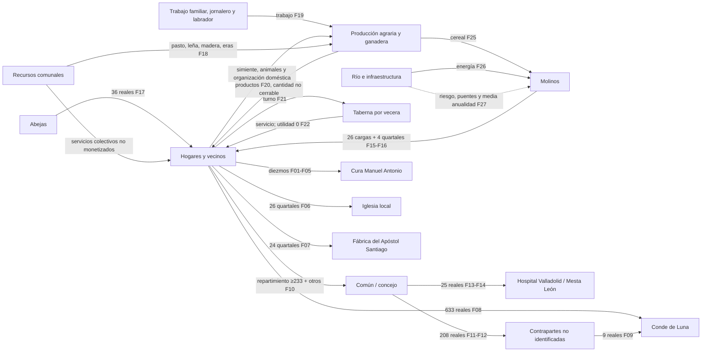
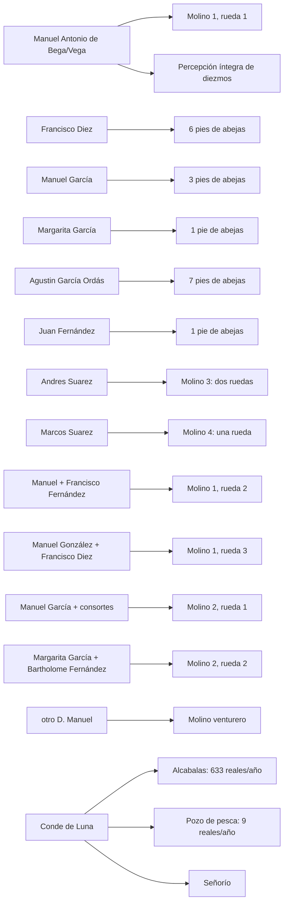

# Matriz de contabilidad social histórica y grafo económico

## Sorribos y Santibáñez de Ordás en 1752

**Estado:** análisis derivado activo  
**Versión:** 0.4 — formalización de cuentas y red económica  
**Fecha:** 16 de septiembre de 2026  
**Base documental exclusiva:** `project/20_TRABAJO_EDITORIAL/Edicion_Critica.md`, versión 3.5  
**Análisis cuantitativo de apoyo:** `project/30_RESULTADOS/ESTUDIO_HISTORICO/Analisis_Cuantitativo.md`, versión 0.2  
**Reconstrucción económica de apoyo:** `project/30_RESULTADOS/ESTUDIO_HISTORICO/Reconstruccion_Economica_Integrada.md`, versión 0.3  
**Base técnica:** `main@de3dd43bd65191222971da89d22101f3399c0514`  
**Manual aplicable:** Manual Editorial v1.6

## 0. Objeto y criterio de formalización

Este documento transforma la reconstrucción económica integrada en dos representaciones formales complementarias:

1. una **matriz de contabilidad social histórica (MCSH)** para ordenar transferencias entre hogares e instituciones;
2. un **grafo económico multiplex** para representar simultáneamente producción, recursos comunes, activos, personas y derechos.

No se construye una Social Accounting Matrix moderna cerrada. El expediente no contiene ingresos y gastos completos de todos los actores, ni permite homogeneizar todas las unidades. Por ello:

- una celda vacía significa **flujo no documentado en el corpus**, no cero económico;
- no se crean cuentas de ajuste ni partidas de equilibrio;
- dinero, cereal, lino, trabajo y servicios comunes permanecen en sus unidades documentales;
- las cargas en `cargas` no se convierten a quartales o fanegas;
- no se convierten reales y maravedís a una unidad monetaria única;
- los propietarios de molinos y abejas no forman un sector social independiente: pertenecen a hogares o personas concretas, por lo que sus activos se presentan en cuentas satélite;
- el análisis mantiene separados **dato documental (D)**, **cálculo interno (C)** e **interpretación (I)**.

La finalidad no es estimar una renta total, sino hacer visible la **arquitectura de circulación económica** que el Catastro permite documentar.

---

# 1. Arquitectura de cuentas

La formalización distingue dos niveles.

## 1.1. Cuentas institucionales principales

| Código | Cuenta | Contenido |
|---|---|---|
| HOG | Hogares / vecinos productores | producción doméstica, trabajo, contribuciones, propiedad privada de activos |
| COM | Común / concejo | repartimientos, gasto colectivo y organización de servicios |
| CUR | Cura Manuel Antonio de Bega/Vega | receptor íntegro de diezmos; también propietario de una rueda, tratada en cuenta satélite |
| IGL | Iglesia local | receptora de la primicia |
| SAN | Fábrica del Apóstol Santiago | receptora del boto |
| CON | Conde de Luna | señorío, alcabalas enajenadas y propiedad del pozo de pesca |
| EXT | Instituciones externas inequívocas | Hospital de Inocentes de Valladolid y derecho de Mesta en León |
| NID | Contraparte no identificada | actor económico que el expediente no permite individualizar |

`NID` no es una cuenta de equilibrio. Solo se usa cuando el propio expediente documenta el flujo pero no permite identificar una de sus contrapartes.

## 1.2. Cuentas satélite de producción y activos

| Código | Cuenta satélite | Razón para mantenerla separada de la MCSH institucional |
|---|---|---|
| AGR | Producción agraria y ganadera | actividad, no actor social independiente |
| TRA | Trabajo familiar, jornalero y de labrador | factor incorporado a hogares y relaciones de servicio |
| COMR | Recursos comunales | pasto, leña, madera, eras, soto y otros servicios no monetizados |
| MOL | Molinos hidráulicos | activos de hogares/personas y renta productiva en especie |
| API | Apicultura | activo privado con utilidad monetaria regulada |
| TAB | Taberna por vecera | servicio colectivo rotatorio sin renta declarada |
| RIO | Río e infraestructura hidráulica | recurso natural, energía y riesgo, no institución |

---

# 2. Libro mayor de flujos documentados

Cada flujo recibe un identificador estable para poder reutilizarlo en la matriz y en los grafos.

| ID | Origen | Destino | Flujo | Magnitud | Nivel | Folios / respuesta |
|---|---|---|---|---|---|---|
| F01 | HOG / productores | CUR | diezmo de centeno | 30 cargas/año | D | R16, 315r |
| F02 | HOG / productores | CUR | diezmo de cebada | 2 cargas/año | D | R16, 315r |
| F03 | vecinos que siembran fuera del término | CUR | diezmo de trigo | 5 fanegas/año | D | R16, 315r |
| F04 | HOG / productores | CUR | diezmo de lino | 40 haces × 4 libras = 160 libras/año | D+C | R16, 315r |
| F05 | HOG / productores | CUR | diezmos menudos | 140 reales/año | D | R16, 315r |
| F06 | HOG / productores | IGL | primicia | 26 quartales de centeno | D | R16, 315r |
| F07 | HOG / productores | SAN | boto | 24 quartales; producto elidido | D | R16, 315r |
| F08 | HOG / vecinos | CON | alcabalas enajenadas | 633 reales/año | D | R28, 319r–319v |
| F09 | NID / arrendatario | CON | renta del pozo de pesca | 9 reales/año | D | R29, 319v |
| F10 | HOG / vecinos | COM | repartimiento | al menos 233 reales + otras cantidades | D+C | R25, 318v–319r |
| F11 | COM | NID | gasto de Corpus | 200 reales/año | D | R25, 318v |
| F12 | COM | NID | limpieza de fuentes | 8 reales/año | D | R25, 318v |
| F13 | COM | EXT / Hospital de Inocentes, Valladolid | pago institucional | 15 reales/año | D | R25, 318v |
| F14 | COM | EXT / Mesta, León | derecho | 10 reales/año | D | R25, 318v |
| F15 | MOL | titulares de ruedas fijas | utilidad productiva | 26 cargas de centeno/año | D+C | R17, 315r–316r |
| F16 | MOL venturero | titular `otro D[o]n Manuel` | utilidad productiva | 4 quartales de centeno | D | R17, 316r |
| F17 | API | cinco titulares | utilidad regulada | 36 reales/año | D+C | R19, 316v |
| F18 | COMR | HOG / ganado / AGR | pasto, leña, madera, resguardo del cereal | sin magnitud monetaria | D | R4 y R12, 307v–308v y 314r |
| F19 | TRA / hogares | AGR | trabajo agrario | 18 jornaleros y 24 labradores; días no declarados | D | R35, 320r–320v |
| F20 | AGR | HOG | cereal, lino, yerba, ganado y otros productos | cantidad agregada no reconstruible | I apoyada en D | R11–R12 y R20 |
| F21 | HOG | TAB | prestación por vecera | turno vecinal; sin utilidad declarada | D | R29, 319v |
| F22 | TAB | HOG | servicio de taberna | utilidad fiscal 0 | D | R29, 319v |
| F23 | arrendamiento animal no individualizado | propietario no individualizado | buey `dado arenta` | 5 quartales de centeno por buey | D | R20, 318r |
| F24 | arrendamiento animal no individualizado | propietario no individualizado | vaca `dado arenta` | 4 quartales de centeno por vaca | D | R20, 318r |
| F25 | AGR | MOL | cereal para molienda | volumen no declarado | I apoyada en función documental del molino | R17 |
| F26 | RIO | MOL | energía hidráulica | sin precio separado | D/I | R17 |
| F27 | RIO / crecidas | MOL e infraestructura | interrupción y daño | algunas ruedas medio año; puentes arrastrados | D | R17 |

Los flujos F20 y F25 son relaciones funcionales necesarias para representar el sistema, pero sus cantidades no figuran como totales en el manuscrito. Por eso se marcan como interpretación apoyada en datos, no como magnitud documental.

---

# 3. Matriz de contabilidad social histórica institucional

Convención: **las columnas son el origen/pagador y las filas el receptor**. Las celdas contienen los identificadores de flujo y su magnitud documental. Una celda `—` significa que el corpus no documenta un flujo entre esas cuentas.

| Receptor \ Origen | HOG | COM | CUR | IGL | SAN | CON | EXT | NID |
|---|---|---|---|---|---|---|---|---|
| **HOG** | — | — | — | — | — | — | — | — |
| **COM** | F10: ≥233 reales + otras cantidades | — | — | — | — | — | — | — |
| **CUR** | F01 30 cargas centeno; F02 2 cargas cebada; F03 5 fanegas trigo; F04 160 lb lino; F05 140 reales | — | — | — | — | — | — | — |
| **IGL** | F06: 26 quartales centeno | — | — | — | — | — | — | — |
| **SAN** | F07: 24 quartales, producto no explicitado | — | — | — | — | — | — | — |
| **CON** | F08: 633 reales | — | — | — | — | — | — | F09: 9 reales |
| **EXT** | — | F13+F14: 25 reales | — | — | — | — | — | — |
| **NID** | — | F11+F12: 208 reales | — | — | — | — | — | — |

## 3.1. Qué revela la matriz

La matriz tiene una asimetría visible: el expediente describe con mucho detalle **transferencias desde productores y vecinos hacia instituciones**, pero casi no describe el gasto posterior de Cura, Iglesia, Fábrica de Santiago o Conde. Esta asimetría es documental, no una afirmación de que esos receptores no recircularan renta.

El único circuito institucional para el que se observa de forma parcial tanto entrada como salida es el del **común**:

`HOG → COM → gastos y transferencias`.

La matriz tampoco incorpora como pagos institucionales los servicios de los recursos comunales ni las utilidades de molinos y abejas, porque pertenecen a capas productivas distintas y, si se mezclaran con HOG como cuentas independientes, se duplicaría a sus titulares.

---

# 4. Submatriz monetaria observada

Se aíslan únicamente flujos expresados directamente en reales. No se convierten cargas, fanegas, quartales, libras ni maravedís.

| Receptor | Pagador | Reales/año documentados | Observación |
|---|---|---:|---|
| CUR | HOG | 140 | diezmos menudos |
| CON | HOG | 633 | alcabalas |
| CON | NID | 9 | renta del pozo |
| COM | HOG | ≥233 | repartimiento; existen otras cantidades |
| EXT | COM | 25 | 15 Valladolid + 10 León |
| NID | COM | 208 | Corpus + limpieza de fuentes; receptor económico final no identificado |

No deben sumarse todas las filas como si fueran producto o renta: F10 financia F11–F14 y una suma vertical mezclaría etapas sucesivas del mismo circuito.

## 4.1. Cuenta parcial del común

Entradas explícitas mínimas:

- de vecinos por repartimiento: **≥233 reales**, más otras cantidades no cuantificadas.

Salidas expresamente desglosadas:

- Corpus: 200;
- fuentes: 8;
- Hospital de Inocentes: 15;
- Mesta: 10;
- subtotal: **233 reales**;
- además, `otras Cantidades`.

La igualdad 200 + 8 + 15 + 10 = 233 permite cerrar **el subtotal conocido**, pero no la cuenta anual completa del común.

## 4.2. Salida geográfica inequívoca mínima

De los 233 reales del subtotal conocido del común, 25 tienen un destino geográfico explícitamente exterior al término:

- 15 a Valladolid;
- 10 a León.

Por tanto:

- 25 / 233 = **10,73%** del gasto común explícito tiene destino exterior inequívoco;
- 25 / 1.006 = **2,49%** del mínimo monetario institucional de 1.006 reales calculado previamente es una salida geográfica externa inequívoca.

La segunda cifra es solo un **suelo documental** de salida exterior. No clasifica geográficamente los 633 reales del Conde ni el boto, porque el expediente no proporciona aquí la información necesaria para hacerlo.

---

# 5. Cuentas satélite productivas

## 5.1. Agricultura y ganadería

La cuenta AGR recibe factores y servicios y genera productos, pero no puede cerrarse monetariamente.

### Entradas documentadas o funcionales

- trabajo familiar, jornalero y de labrador: F19;
- simiente: respuesta 9;
- animales de labor: respuesta 20;
- pastos, leña, madera y otros servicios comunales: F18;
- tierra por clases y calidades: respuestas 4, 5 y 10.

### Salidas

- cereal, lino/linaza, yerba y producción ganadera hacia hogares: F20, sin total agregado;
- cereal hacia molienda: F25, sin volumen;
- cargas eclesiásticas en especie: F01–F07;
- excedentes o autoconsumo: no separables con el corpus vigente.

**Resultado:** AGR es el núcleo material del sistema, pero no puede transformarse en una cuenta de explotación completa.

## 5.2. Molinos

La cuenta MOL sí tiene una salida de utilidad regulada parcialmente cerrable:

- ocho ruedas fijas: **26 cargas de centeno**;
- molino venturero: **4 quartales de centeno**.

La distribución de las 26 cargas cierra aritméticamente:

`2 + 2 + 2 + 4 + 4 + 8 + 4 = 26 cargas`.

El venturero se conserva aparte por usar quartales.

No conocemos:

- volumen total molido;
- maquila o mecanismo exacto que produce la utilidad;
- costes de reparación;
- proporciones internas de copropiedad.

## 5.3. Apicultura

La cuenta API es la cuenta productiva mejor cerrada del expediente:

- 18 pies de abejas × 2 reales = **36 reales/año**;
- distribución por titulares: 14 + 12 + 6 + 2 + 2 = **36 reales**.

La distribución física también cierra:

`7 + 6 + 3 + 1 + 1 = 18 pies`.

## 5.4. Trabajo

La cuenta TRA tiene una estructura social explícita:

`18 jornaleros = 14 hijos de familia + 3 criados sirvientes + 1 jornalero exclusivo`.

Utilidades diarias:

- jornalero: 2,5 reales, incluida comida de 1,5;
- labrador: 3 reales, incluida comida de 1,5;
- herrero: +0,5 real por el oficio, además de su actividad de labrador.

No se anualiza porque no se conocen días trabajados.

---

# 6. Grafo económico de primer nivel: sistema completo

El siguiente grafo representa relaciones documentales y funcionales. Las etiquetas monetarias o en especie solo aparecen cuando el expediente las cuantifica.

## 6.1. Lectura del grafo

El grafo hace visibles cinco rasgos estructurales:

1. **HOG y AGR forman el núcleo**, pero no son equivalentes: el hogar aporta trabajo, simiente y organización y recibe productos, mientras AGR representa la actividad productiva.
2. **COMR entra como factor productivo sin precio particular**, lo que muestra por qué una lectura exclusivamente monetaria infravalora los comunes.
3. **RIO es simultáneamente input y riesgo** para MOL.
4. **Las instituciones reciben flujos heterogéneos**: dinero, cereal y lino.
5. **COM es un nodo de recaudación y redistribución**, no un rentista con propios.

---

# 7. Grafo de segundo nivel: personas, activos y derechos

Este grafo desagrega los nodos con titularidad explícita. No se asignan porcentajes de copropiedad no documentados.

El grafo agrupa algunas copropiedades en nodos colectivos para no atribuir a cada persona una fracción que el expediente no declara. Francisco Diez, Manuel García y Margarita García aparecen además individualmente en la apicultura, lo que permite reconocer su diversificación sin fingir cuotas internas en los molinos.

---

# 8. Nodos multiplex y concentración por dominios

No se calcula riqueza total ni centralidad ponderada. Sí puede contarse el número de **dominios económicos distintos** en los que cada actor aparece explícitamente.

| Actor | Dominios documentados | Lectura controlada |
|---|---|---|
| Conde de Luna | señorío; alcabalas; pozo de pesca | concentración de derechos de naturaleza distinta |
| Manuel Antonio de Bega/Vega | diezmos; rueda de molino | combinación de derecho eclesiástico y activo productivo |
| Francisco Diez | rueda de molino; abejas | diversificación productiva; además es perito, rol no contado como activo |
| Manuel García | rueda con consortes; abejas | diversificación productiva |
| Margarita García | rueda compartida; abejas | diversificación productiva |
| Andres Suarez | dos ruedas del molino 3 | concentración dentro de un mismo dominio hidráulico |
| Marcos Suarez | una rueda | activo hidráulico individual |
| Agustin García Ordás | siete pies de abejas | mayor titular apícola |

**Interpretación:** el sistema combina una propiedad productiva relativamente repartida con nodos que acumulan varios tipos de relación. El número de dominios no es un índice de riqueza: una alcabala, una rueda y un pie de abeja no son magnitudes comparables.

---

# 9. Circuitos de circulación identificados

## 9.1. Circuito doméstico-productivo

`hogar → trabajo / simiente / animales → producción → producto → hogar`

Este circuito es el corazón económico, pero no puede cerrarse porque faltan cantidades agregadas de producto, autoconsumo y semilla reservada.

## 9.2. Circuito comunal

`hogares → repartimiento → común → gastos y obligaciones`

A la vez:

`recursos comunales → pasto / leña / madera / infraestructura → hogares y producción`.

El circuito comunal es, por tanto, doble: monetario en una dirección y no monetizado en la otra.

## 9.3. Circuito eclesiástico

`producción / hogares → diezmos → cura`

`producción / hogares → primicia → iglesia local`

`producción / hogares → boto → fábrica de Santiago`.

El expediente registra bien la entrada de recursos, pero no el destino posterior de lo recibido.

## 9.4. Circuito señorial

`vecinos → 633 reales de alcabalas → Conde`

`arrendatario no identificado → 9 reales → Conde`.

El señorío no se reduce a renta del suelo: la respuesta 22 declara cero pago por establecimiento del suelo.

## 9.5. Circuito de transformación

`cereal → molinos → utilidad en centeno → titulares`.

El río condiciona simultáneamente capacidad y riesgo de este circuito.

## 9.6. Circuito de servicios colectivos no empresariales

`vecinos → turno de vecera → taberna → servicio a vecinos`.

La utilidad declarada es cero, pero el servicio existe. Es un ejemplo claro de actividad económica que la renta fiscal no captura.

---

# 10. Controles de cierre que sí son posibles

| Cuenta / relación | Control | Resultado |
|---|---|---|
| Jornaleros | 14 hijos + 3 criados + 1 exclusivo | 18 = 18 |
| Abejas físicas | 7 + 6 + 3 + 1 + 1 | 18 = 18 |
| Abejas monetarias | 14 + 12 + 6 + 2 + 2 reales | 36 = 36 |
| Molinos fijos | 3 + 2 + 2 + 1 ruedas | 8 = 8 |
| Utilidad molinos fijos | 2 + 2 + 2 + 4 + 4 + 8 + 4 cargas | 26 = 26 |
| Gastos comunes conocidos | 200 + 8 + 15 + 10 reales | 233 = 233 |
| Lino del diezmo | 40 haces × 4 libras | 160 libras |
| Cerda de cría | 4 cerdos × 4 reales | 16 reales/año |
| Vaca | 22 reales cada dos años | 11 reales/año |
| Yegua | alternancia 200 / 50 | 125 reales/año |

Estos cierres aumentan la confianza en relaciones internas concretas, pero no convierten el expediente en una contabilidad macroeconómica completa.

---

# 11. Cuentas que no pueden cerrarse

## 11.1. Hogares

No conocemos de forma agregada:

- producto total recibido;
- autoconsumo;
- venta;
- compra exterior;
- semilla retenida;
- días de trabajo;
- pagos privados entre hogares;
- distribución completa de tierras y ganado.

## 11.2. Cura, Iglesia, Santiago y Conde

Conocemos entradas concretas, pero no sus gastos o redistribuciones posteriores dentro o fuera de la comunidad.

## 11.3. Común

El subtotal de 233 reales cierra aritméticamente, pero la frase `y mas, y otras Cantidades` impide cerrar el presupuesto anual completo.

## 11.4. Producción

No existe una unidad física única para sumar centeno, cebada, linaza, lino, yerba, lana y ganado; tampoco una base monetaria interna completa que permita valorar todo sin supuestos externos.

---

# 12. Mapa de información faltante revelado por la formalización

La matriz y el grafo permiten distinguir qué información adicional sería necesaria para responder preguntas que hoy siguen abiertas.

| Pregunta | Información que falta en el corpus vigente |
|---|---|
| ¿Cuál era el producto agrario total? | superficies homogéneas o equivalencias completas, distribución de cultivos por año y cantidades agregadas |
| ¿Cuál era la renta de cada hogar? | propiedad individual de tierras y ganado, producción, ventas, costes y días de trabajo |
| ¿Cuánta riqueza salía del pueblo? | residencia/destino efectivo de receptores, circulación posterior de diezmos y alcabalas, comercio exterior |
| ¿Qué desigualdad patrimonial existía? | inventario completo de tierras, ganado, vivienda, deudas y activos por persona/hogar |
| ¿Qué peso tenía el mercado? | cantidades vendidas/compradas y precios efectivos de transacción |
| ¿Qué valor tenían los comunes? | cantidades físicas utilizadas o valoración documental de sus servicios |
| ¿Qué intensidad tenía la molienda? | volumen molido, maquilas, costes y calendario efectivo de operación |

Responder a estas preguntas requeriría ampliar el corpus y, por tanto, aprobar un criterio metodológico nuevo antes de incorporarlas como resultados del Estudio Histórico.

---

# 13. Resultado interpretativo

La formalización confirma que Sorribos y Santibáñez no pueden describirse adecuadamente como una suma de explotaciones privadas independientes ni como una economía monetaria simple.

El **hogar agrario** concentra trabajo, producción, consumo, propiedad de activos y obligaciones. A su alrededor operan tres capas que modifican profundamente esa economía doméstica:

1. una **capa comunal**, que proporciona inputs no monetizados y recauda repartimientos para gastos colectivos;
2. una **capa institucional**, que canaliza diezmos, primicia, boto y alcabalas hacia receptores con títulos diferenciados;
3. una **capa de activos y transformación**, en la que molinos, abejas, ganado y servicios rotatorios generan utilidad o capacidad productiva sin constituir sectores sociales separados de los hogares.

La red económica es por ello **multiplex**: una misma persona puede ser productor, propietario de molino, apicultor, perito o eclesiástico. La separación moderna entre hogar, empresa, trabajo, fiscalidad y servicios públicos no aparece nítida en la documentación.

La principal aportación de la MCSH es negativa y positiva al mismo tiempo. Negativamente, demuestra dónde no puede cerrarse una cuenta sin inventar información. Positivamente, identifica con precisión los circuitos que sí están documentados, sus unidades originales y sus puntos de conexión.

El modelo resultante puede resumirse así:

`recursos naturales y comunes + hogares + trabajo → producción → consumo / activos / cargas`

sobre la que se superponen:

`redistribución comunal + derechos eclesiásticos + derechos señoriales + conexiones exteriores`.

Esta es la representación formal más completa que permite actualmente el corpus aprobado sin introducir equivalencias externas ni documentación adicional.

---

# 14. Siguiente profundización posible dentro del corpus vigente

Sin ampliar fuentes todavía, esta formalización permite una extensión adicional: construir un **mapa de vulnerabilidades económicas** que use como nodos el barbecho del centeno, la calidad de las tierras, la dependencia de los comunes, el riesgo hidráulico, la ausencia de propios y la concentración de determinadas cargas. Ese mapa no requeriría nuevas fuentes si se limita a relaciones ya documentadas y distingue con claridad dato e interpretación.