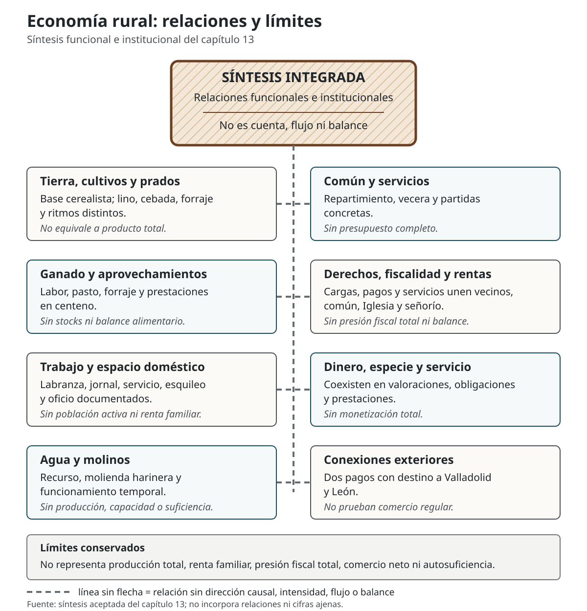

Los capítulos anteriores, hasta el dedicado a
[dinero, oficios y conexiones exteriores](12-dinero-oficios-conexiones-exteriores.qmd),
han separado territorio, población documental, trabajo, tierras, ganado,
agua, transformación, derechos, hacienda y dinero.
Este cierre de la Parte II cambia la escala de la pregunta: no añade una cuenta
nueva, sino que examina cómo se relacionan esos componentes y hasta dónde
pueden sostener una explicación conjunta.

En este capítulo, **economía rural integrada** significa un conjunto local de
actividades, recursos y obligaciones relacionados entre sí. No significa una
economía integrada en mercados regionales, autosuficiente, equilibrada,
sostenible o resiliente. La integración que puede defenderse es funcional e
institucional; su intensidad, sus resultados y su capacidad de respuesta ante
crisis no son magnitudes observadas. [I/L: INT-002, INT-007, INT-009, INT-010,
LIM-002, LIM-003, LIM-009]

## Un sistema de relaciones internas {#economia-integrada-alcance}

La expresión designa un **conjunto local de actividades, recursos y
obligaciones relacionados entre sí**; no significa una economía integrada en
mercados regionales.

La unidad local declarada pertenece al señorío del conde de Luna y comparece
en el marco del Concejo de Ordás. Dentro de ella actúan sujetos que no deben
fundirse: vecinos, común del lugar, concejo, perceptores eclesiásticos y
titulares de derechos o recursos. El señorío forma parte de esta arquitectura,
pero no explica por sí solo todas las tierras, trabajos, pagos o usos. [D/L:
JUR-001, JUR-002, JUR-005, JUR-006, LIM-011]

| Componente | Relación documentada o interpretación autorizada | Límite que se conserva |
|---|---|---|
| Tierra, cultivos y prados | La base cerealista convive con lino, cebada, forraje y ritmos distintos. | Rendimientos regulados no son cosecha ni producto total. |
| Ganado y aprovechamientos | Animales de labor, forraje, pasto y prestaciones en centeno enlazan funciones agrarias. | No constan efectivos, balance alimentario ni propiedad común general. |
| Río y molinos | El agua mueve molinos harineros y condiciona funcionamientos temporales. | Existencia y utilidad no miden producción, capacidad o suficiencia. |
| Trabajo y espacio doméstico | Labranza, jornal, servicio, esquileo y un oficio se cruzan en casos documentados. | No hay población activa, número exacto de hogares ni renta familiar. |
| Derechos y hacienda | Cargas, pagos y servicios conectan vecinos, común, Iglesia y señorío. | No forman presión fiscal total, presupuesto o balance local. |
| Dinero, especie y servicio | Las tres formas coexisten en valoraciones, obligaciones y prestaciones. | No permiten calcular grado de mercado, comercio neto o monetización total. |

La tabla expresa conexiones, no una contabilidad de entradas y salidas. Cada
fila mantiene la naturaleza fijada en los capítulos 5–12 y en el Registro:
valor no equivale a producción, utilidad no equivale a ingreso, uso no equivale
a propiedad y obligación no equivale a gasto ejecutado.

### Lectura visual de las relaciones {#economia-diagrama-relaciones}

El diagrama traduce esa misma tabla a una lectura relacional. Sus líneas no
tienen flechas porque expresan conexiones documentadas o interpretaciones
acotadas, no direcciones causales, intensidades, flujos o balances.

{#fig-diagrama-economia-rural .visual-apparatus fig-alt="Diagrama sin flechas con ocho componentes relacionados: tierra, ganado, trabajo, agua y molinos, común y servicios, derechos y fiscalidad, dinero y prestaciones, y dos pagos exteriores. Mantiene explícitos los límites de cálculo e interpretación del capítulo 13." fig-pos="H" width="100%"}

::: {.visual-source}
**Fuente:** síntesis aceptada del capítulo 13, en especial la tabla anterior.
No incorpora cifras, causalidades ni relaciones ajenas a este capítulo.
:::

## Base agraria y complementariedades {#economia-base-agraria}

Dentro de la cabida cultivada comparable, las tierras centenales reúnen
2.750,5 de 2.953,5 medidas principales, el 93,13 %. Sobre el subtotal más
amplio de 3.811,5 medidas principales representan el 72,16 %. Los dos
porcentajes conservan denominadores distintos y sostienen una **base
marcadamente centenaria**, no un monocultivo probado ni una distribución exacta
de todo el término. Tampoco convierten el índice anualizado de 1.578,25
unidades en superficie efectivamente sembrada. [C/I/L: AGR-004, AGR-005,
AGR-006, CAL-003, CAL-004, CAL-005, CAL-006, INT-001, LIM-003, LIM-004,
LIM-007]

Esa centralidad coexiste con ferrañales, lino, linaza, cebada, prados y usos
arbóreos. Las alternancias de los linares y el descanso bienal de las tierras
centenales introducen ritmos diferentes. Bueyes y vacas aparecen asociados a
la labranza; los ferrañales y prados aportan forraje o hierba; otros espacios
sostienen pasto. Puede hablarse de complementariedad funcional entre
agricultura, ganado y recursos territoriales, pero no de equilibrio material:
faltan efectivos ganaderos, consumos, producción anual y distribución de los
recursos. [D/I/L: AGR-001, AGR-002, AGR-003, GAN-001, GAN-002, INT-002,
INT-003, INT-004, LIM-003, LIM-009]

Los aprovechamientos de uso común documentado añaden pasto, leña, reparación
de puentes y resguardo del cereal. Esas funciones conectan ganadería,
infraestructura y producción, pero **uso común no equivale a propiedad
comunal**. Tampoco constan reglas completas de acceso, administración,
disponibilidad o capacidad de reposición. [D/I: GAN-002, INT-004]

## Agua, transformación y recursos complementarios {#economia-agua-transformacion}

El río proporciona una relación técnica directa: mueve cuatro casas de
molinos con ocho ruedas descritas; además existe un molino venturero cuyo
número de ruedas no consta. Las utilidades de las ocho ruedas suman 26 cargas
de centeno, pero siguen siendo utilidades reguladas, no volumen molido. El
carácter harinero y el predominio cerealista permiten situar la molienda dentro
del sistema agrario; no prueban que todo el cereal fuese local, que todos los
vecinos moliesen allí o que la capacidad bastara para sus necesidades. [D/C/I/L:
HID-001, HID-002, HID-004, HID-005, CAL-012, CAL-013, INT-002, LIM-005,
LIM-009, LIM-010]

La misma relación descubre una dependencia. Algunas ruedas muelen solo la
mitad del año y el venturero trabaja algunos meses de invierno; el expediente
asocia además una regulación reducida con el daño del río a los puentes. Esto
acredita limitación temporal y un factor físico compartido, no una
paralización simultánea ni una crisis de abastecimiento observada. [D/I:
HID-005, HID-006, INT-005]

Colmenas y pozo de pesca amplían los recursos registrados. Los 36 reales de
utilidad apícola regulada y los nueve reales de utilidad del pozo conservan
naturalezas separadas y no forman una renta sectorial. Su presencia muestra
variedad de activos; no mide producción de miel, cera o pesca, reparto doméstico
ni diversificación general de ingresos. [D/C/L: GAN-003, GAN-005, FIS-012,
LIM-008, LIM-009, LIM-011]

## Trabajo, dinero e instituciones {#economia-trabajo-instituciones}

Las respuestas enlazan trabajo y ámbito doméstico sin permitir reconstruir una
cuenta por hogar. Catorce jornaleros viven con sus padres, tres son criados
sirvientes y uno se dedica solo al jornal; el esquileo se realiza en las
habitaciones; un herrero pasa la mayor parte del año como labrador. Son formas
documentadas de dependencia familiar, servicio y pluriactividad individual,
no un modelo universal para todas las casas. Los 18 jornaleros, 24 labradores
y el herrero-labrador no se suman como población activa, y sus utilidades
diarias no son ingresos anuales. [D/I/L: GAN-007, TRA-001, TRA-002, TRA-003,
TRA-004, INT-008, LIM-001, LIM-002, LIM-008]

El dinero interviene como lenguaje de valoración y como medio de determinados
pagos; convive con cereal, lino, utilidades molineras y servicios. El mínimo
institucional de 1.006 reales reúne tres magnitudes anuales parciales de
naturaleza distinta. No es producción, renta local, presión fiscal total ni
circulación monetaria completa. Los 25 reales con destino inequívoco a
Valladolid y León acreditan dos pagos exteriores, no comercio regular. [C/I/L:
FIS-009, FIS-010, FIS-011, CAL-014, CAL-015, CAL-016, CAL-017, INT-007,
LIM-002, LIM-009, LIM-012, LIM-013]

El común declara carecer de propios, arbitrios y renta, debe satisfacer
partidas concretas y las financia mediante repartimiento entre los vecinos.
La taberna por *vecera* añade un servicio rotatorio sin utilidad declarada.
Repartimiento y turno son mecanismos operativos documentados; no prueban un
presupuesto completo, solvencia, cobertura estable o capacidad de recuperación
ante una perturbación. [D/I: FIS-005, FIS-006, FIS-007, TRA-005, INT-006]

## Dependencia, exposición y daño {#economia-dependencias}

El análisis de vulnerabilidad exige tres niveles separados: **dependencia
documentada**, **exposición plausible derivada de ella** y **crisis o daño
observado**. El expediente alcanza con seguridad el primero en varios casos y
permite formular el segundo con cautela; no documenta una crisis económica
general en 1752. [I: INT-009]

| Dependencia documentada | Exposición que puede plantearse | Daño que no se afirma |
|---|---|---|
| Predominio centenal y descanso bienal | Una perturbación cerealista afectaría al componente territorial dominante y a prestaciones en centeno. | No consta mala cosecha general, escasez ni hambre. |
| Agua compartida por los molinos y funcionamiento temporal | Una alteración hídrica podría reducir molienda o utilidad. | No consta paralización conjunta ni crisis de abastecimiento. |
| Funciones ganaderas y materiales de aprovechamientos de uso común | Una restricción podría alcanzar pasto, combustible, cereal o reparaciones. | No consta esa restricción ni su impacto histórico. |
| Gastos del común financiados por repartimiento | Una necesidad adicional podría trasladarse a los vecinos. | No constan insolvencia, impago o colapso financiero. |

La ausencia de datos sobre reservas, crédito, cosechas efectivas o distribución
doméstica no constituye por sí misma vulnerabilidad histórica. Es un límite de
observación. Del mismo modo, una dependencia funcional no equivale a causalidad
demostrada entre fiscalidad, producción, señorío y bienestar.

## Diversidad y mecanismos potencialmente amortiguadores {#economia-diversidad-amortiguadores}

El expediente documenta diversidad de actividades y recursos: cultivos con
ritmos diferentes, prados, varias especies ganaderas, molinos, colmenas, pesca,
labranza, jornal, herrería y servicios rotatorios. Esta variedad amplía las
funciones del sistema local. No demuestra diversificación de ingresos en cada
hogar, sustitución completa entre actividades ni compensación cuantificable de
una pérdida. [I/L: INT-002, INT-003, INT-008, INT-009, LIM-002, LIM-008,
LIM-009]

La pluralidad de casas, ruedas y titulares ofrece **redundancia potencial de
unidades**; todas comparten, sin embargo, la dependencia del río y no consta
que pudieran sustituirse entre sí. Los recursos de uso común podían aportar
funciones diferentes, pero no se conocen su suficiencia o sus reglas completas.
Repartimiento y *vecera* muestran capacidades de organización para obligaciones
y un servicio concreto, no respuestas observadas a un choque. Son mecanismos
potencialmente amortiguadores, no garantías de estabilidad. [I: INT-004,
INT-005, INT-006, INT-009]

## Vulnerabilidades defendibles {#economia-vulnerabilidades}

Pueden defenderse cuatro exposiciones estructurales y acotadas: concentración
relativa del cultivo comparable en el centeno; ritmos de descanso que limitan
la lectura de la cabida como superficie activa; dependencia hidráulica de la
molienda; y dependencia del repartimiento para las partidas del común. También
puede señalarse que varias funciones descansan en espacios de uso común
documentado. Ninguna de estas formulaciones atribuye probabilidad, intensidad
o consecuencias efectivamente sufridas. [I: INT-001, INT-003, INT-004,
INT-005, INT-006, INT-009]

No se usa la falta de una cifra como prueba de fragilidad. Desconocer reservas,
deudas, cuotas personales, existencias ganaderas o producción no demuestra que
fueran insuficientes. Tampoco los 1.006 reales parciales permiten medir presión
fiscal, ni los 233 reales del común un presupuesto completo. La vulnerabilidad
analítica termina donde faltan el universo y el mecanismo observables. [I/L:
INT-010, LIM-002, LIM-003, LIM-008, LIM-009]

## Resiliencia: una pregunta, no un resultado {#economia-resiliencia-limites}

Para afirmar resiliencia en sentido fuerte harían falta un choque, una
respuesta, una recuperación o una adaptación observables. El expediente no
documenta esa secuencia. Por ello no se afirma que el sistema fuera resiliente,
que soportara bien las crisis o que su diversidad garantizara estabilidad.
[I: INT-009]

Sí pueden describirse combinación de actividades, fuentes alternativas de
utilidad, pluralidad de unidades y mecanismos colectivos. Son posibilidades
de amortiguación cuya eficacia no puede medirse. La pluriactividad está probada
para el herrero-labrador, no para todos los hogares; la pluralidad molinera no
garantiza continuidad; el uso común no garantiza acceso suficiente; y la
vecera no prueba una capacidad general de adaptación.

## Los límites de la reconstrucción {#economia-limites-reconstruccion}

La integración de los capítulos 5–12 no completa los denominadores ausentes.
No pueden reconstruirse con seguridad población individual, número exacto de
hogares, jornadas anuales, renta familiar, producto agrario total, producción
efectiva, destino de los frutos, stocks ganaderos, reservas, deudas, crédito,
distribución patrimonial, desigualdad, comercio neto, presión fiscal, bienestar
o nivel de vida. No pueden afirmarse autosuficiencia alimentaria,
energética, ganadera, monetaria o económica general. [I/L: INT-010,
LIM-001, LIM-002, LIM-003, LIM-008, LIM-009]

Las medidas históricas conservan además fronteras internas: celemín y medida
principal no se convierten; carga, fanega y *quartal* no forman una escala
completa para las partidas fiscales y molineras; real y maravedí no se
decimalizan mediante una equivalencia externa. Persisten asimismo las
discordancias entre las respuestas 5 y 10 y el número desconocido de ruedas
del venturero. [L: LIM-004, LIM-005, LIM-006, LIM-007, LIM-010]

Las fuentes externas aclaran vocabulario, contexto regional e instituciones:
medición por sembradura, lino, prados, ganado *arenta*, molinos, Voto
de Santiago, Hospital de Inocentes, Mesta, propios y arbitrios. No aportan a
Sorribos cifras, contratos, circuitos comerciales o resultados económicos que
el expediente no contiene. Siguen abiertas la base jurídica concreta de las
alcabalas y del pozo, el origen del pago vallisoletano y la naturaleza precisa
del derecho de Mesta en León. [E/L: TER-011, AGR-011, AGR-012, AGR-013,
GAN-008, HID-008, FIS-013, FIS-014, FIS-015, FIS-016, FIS-017,
LIM-011, LIM-012, LIM-013]
[@castanoalvarez2017apuntes; @bartolomebartolome2001comercio;
@sanchezlopezdevinuesa2001cultivos; @riescochueca2013lexico;
@cortizoalvarez1984ganado; @zapicogutierrez2016molinos;
@hernandezcubero2018recursos; @reycastelao1985voto;
@mazazorrilla1982pobreza; @paresmesta; @garciagarcia1986haciendas;
@caputvallis2008catastro]

## Una economía rural relacionada, no cerrada {#economia-sintesis}

La imagen global defendible es la de una comunidad rural de base agraria y
marcadamente centenaria, con componentes ganaderos, forestales, hidráulicos,
artesanales e institucionales conectados. Tierra y prados sostienen cultivos y
funciones ganaderas; agua y molinos relacionan recurso y transformación;
trabajo doméstico, jornal y oficio se superponen en casos concretos; derechos,
pagos y servicios enlazan vecinos, común, Iglesia y señorío; dinero, especie y
prestaciones circulan sin formar una cuenta única. [I: INT-001, INT-002,
INT-004, INT-007, INT-008]

Esta integración interna no demuestra integración comercial. La variedad no
demuestra resiliencia; la dependencia no prueba crisis; las ausencias del
interrogatorio no prueban autosuficiencia; las valoraciones no miden producción
o bienestar. El resultado es una explicación relacional y trazable, no un
balance total ni una teoría general de la economía campesina.

## De la interpretación al documento {#economia-transicion-manuscrito}

Con esta síntesis concluye la Parte II. La reconstrucción histórica se ha
apoyado en una edición controlada y en una jerarquía explícita de dato,
cálculo, interpretación, contexto y límite. La Parte III vuelve al soporte
material: el [facsímil del expediente](../../generated/14-facsimil.qmd)
permitirá observar la escritura, la disposición y los folios de los que procede
la explicación, sin convertir la imagen en sustituto de la transcripción o del
aparato crítico.

El cambio de parte no añade certeza retrospectiva. Al contrario, devuelve al
lector desde la síntesis a la evidencia material y prepara las vistas
documentales de facsímil, transcripción y edición modernizada que compondrán
las partes siguientes del libro.
